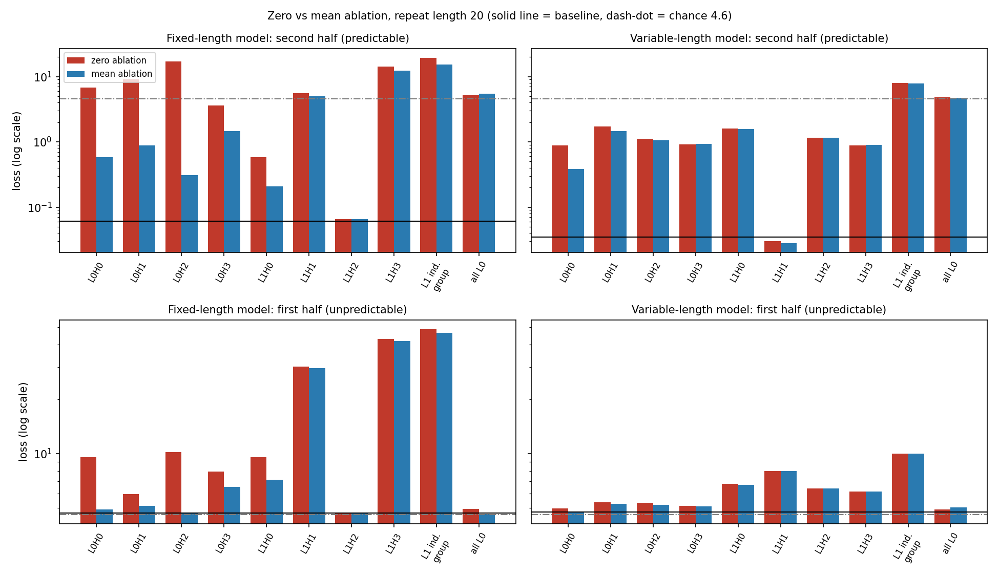
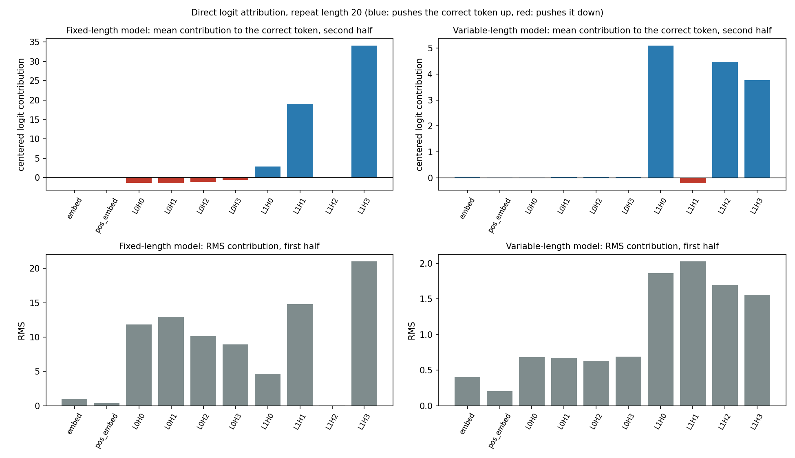
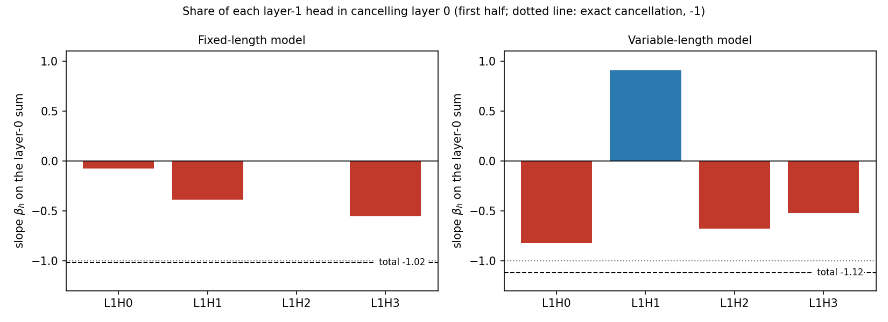
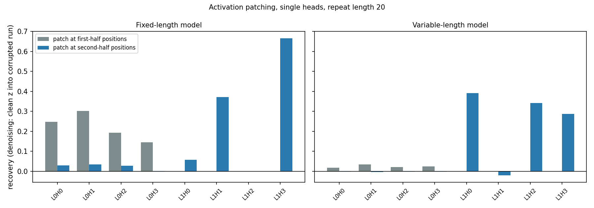
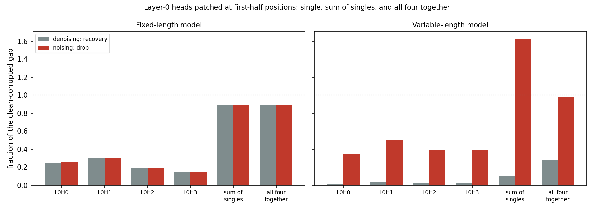
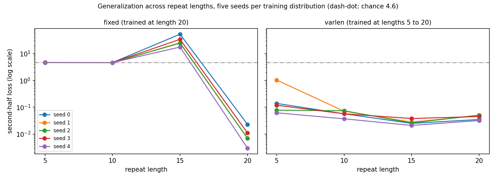
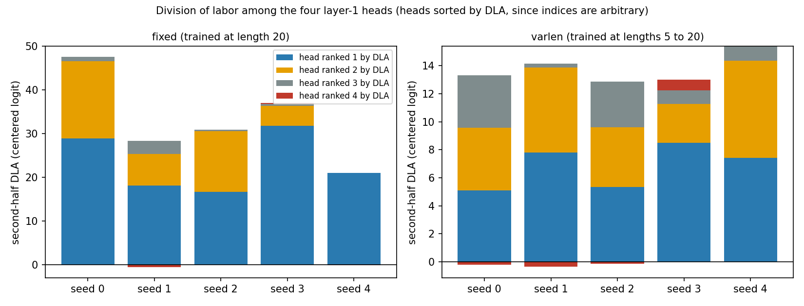
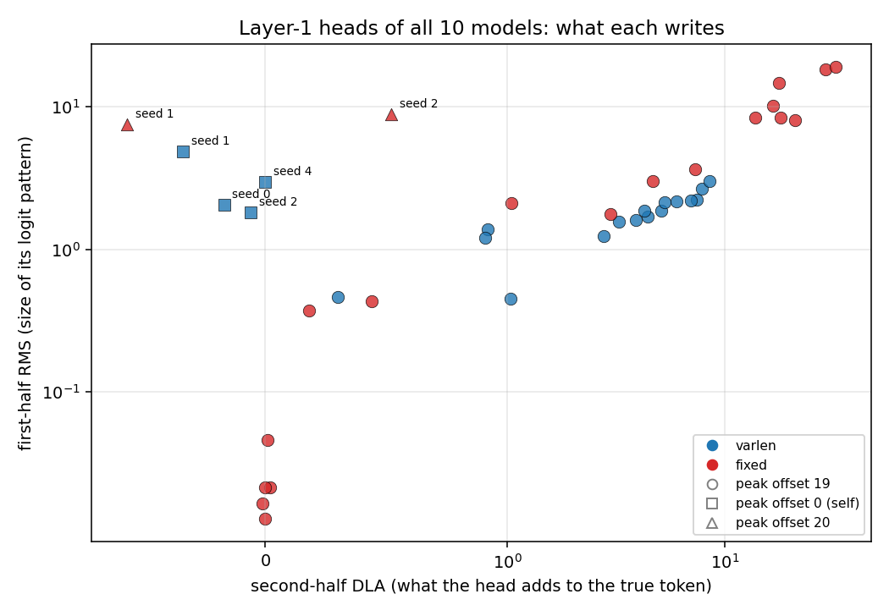
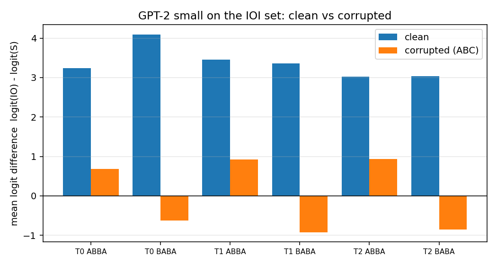

# info.md: theory notes and remarks

Working notes for `mi-toy`, in the order the work happened. Every stage has the
theory behind it, what we did, and what surprised us or had to change. New
stages are appended at the end of Part 1 as we go.

Contents: Part 1 (1.1 task, 1.2 dataset, 1.3 model, 1.4 training and
evaluation, 1.5 hook points, 1.6 reading activations), Part 2, open questions,
glossary.

---

# Part 1: toy model in plain PyTorch

## 1.1 Task and hypothesis

**Theory.** We want a task where we know which mechanism a model needs, so we
can check whether interventions find it. The classic choice is *induction*:

> If the text contains `[A][B] ... [A]`, then after the second `[A]` predict `[B]`.

Each training sequence is a random block of tokens repeated twice, e.g.
`K R P Z K R P Z`. The model is trained only on next-token prediction, at every
position. The tokens are random and meaningless on purpose: language knowledge,
memorization and token statistics cannot help, so the only way to lower the loss
in the repeated part is to look back in the context.

**What we write and what the model learns.** We write the data and the loss. We
do not write any rule such as "check for repeats". Gradient descent keeps
whatever lowers the loss, so some look-back behavior emerges in the weights.
Learning the rule happens across training (weights change). Using the rule
happens inside one forward pass (weights fixed).

**First half vs second half.** This is not a second task or a special input
format. It is only how we group positions when reporting the loss. Training uses
the average over all positions. In the first half the tokens are new random
draws, so even a perfectly trained model is at chance there (about ln(100) =
4.6). The first token of the second half is also unpredictable, because the
model cannot know the repeat is starting. Only the following positions are
predictable.

**Hypothesis.** The model learns the look-back behavior on its own, and
interventions can locate the components responsible. This is a hypothesis to
test, not a guarantee.

**Caveat (planned from the start).** Copying is not necessarily induction. With a
fixed repeat length, a positional shortcut ("predict the token that was
`half_len` positions ago") also scores perfectly. We planned to test on other
repeat lengths and to inspect the attention patterns. This caveat turned out to
matter (see 1.4).

## 1.2 Dataset

**Theory and what we did.** `make_batch(batch_size, half_len, vocab_size)` returns
an integer tensor of shape `(batch_size, 2 * half_len)`: a random half
concatenated with a copy of itself along the sequence dimension. Tokens are
integer ids, because the model never sees letters, only ids. Every training step
draws fresh random sequences, so nothing can be memorized and the training loss
is already a fair measure of generalization.

**Seeding.** `set_seed(seed)` seeds Python's `random`, NumPy and PyTorch. The same
seed gives the same initial weights and the same data stream. The seed is also an
experimental variable: different seeds can end up with different circuits for the
same behavior (the Rashomon question, see Open questions). Seeding gives
repeatability on the same machine and software versions, not bit-exact
determinism on every device.

**Change: sampling without replacement.** The first version drew tokens with
`randint`, and I wrongly claimed duplicates would be rare. It is the birthday
problem: drawing 20 tokens from 50 gives about 4 duplicate pairs per sequence,
and even a vocabulary of 256 leaves roughly a third of sequences with at least
one duplicate. A duplicated token followed by two different tokens makes the
second-half prediction ambiguous for a pure look-back strategy. The fix is to
take the first `half_len` columns of a random permutation of the vocabulary
(`torch.rand(...).argsort(dim=1)[:, :half_len]`), so tokens within a sequence are
distinct. This requires `vocab_size >= half_len`. A side effect: the first-half
loss floor is slightly below ln(vocab), because already-seen tokens are excluded.

## 1.3 Model

**Design choices.** An attention-only transformer, 2 layers, no MLPs, no layer
normalization, no biases. These remove the hardest-to-interpret components and
keep each head to four matrices. Induction needs two layers that compose: a
layer-0 head that moves "what was my previous token" into each position, and a
layer-1 head that uses it to find the position after the earlier occurrence of
the current token and copy from there.

| Config | Value | Meaning |
|---|---|---|
| `vocab_size` | 100 | Distinct tokens |
| `n_ctx` | 40 | Maximum sequence length (2 * 20) |
| `n_layers` | 2 | Attention layers; induction needs two that compose |
| `n_heads` | 4 | Parallel heads per layer; roles are learned |
| `d_head` | 16 | Size of each head's query/key/value/output vector |
| `d_model` | 64 | Residual stream width (4 * 16 by convention, not a constraint) |

**Embeddings.** `W_E` has shape `(vocab_size, d_model)`: a lookup table, one row
per token. The same token gets the same vector everywhere, so we add `W_pos`,
shape `(n_ctx, d_model)`, one learned vector per position (GPT-2 style), because
attention alone has no sense of order. Token vector plus position vector is the
starting value of the **residual stream**. Both tables start as small random
numbers (std 0.02) and are trained.

**Attention.** Each position looks at earlier positions and pulls information
from them. Query: what am I looking for. Key: what do I contain. Value: what do I
hand over if selected. Steps: compare the query with every key (dot product,
divided by sqrt(d_head) so large scores do not saturate the softmax), forbid the
future, softmax into weights that sum to 1, take the weighted sum of the values,
map each head's result back to `d_model` with `W_O` and sum over heads.
Weights are stored per head: `W_Q`, `W_K`, `W_V` have shape
`(n_heads, d_model, d_head)` and `W_O` has shape `(n_heads, d_head, d_model)`, so
heads are separately addressable for interventions. A head splits into a QK
circuit (where it attends) and an OV circuit (what it moves).

**Causal mask.** The model predicts the next token at every position in
parallel. Without the mask, a position could attend to the very token it is
supposed to predict and simply cheat. The mask sets future scores to `-inf`, which
become weight 0 after the softmax, so position `t` only sees `0 ... t`. It does
not fix positions (the positional embedding does that); it prevents looking
ahead.

**Unembedding and assembling.** `W_U`, shape `(d_model, vocab_size)`, turns the
final residual vector into one score (logit) per token. It is a separate learned
matrix, not the transpose of `W_E` (no weight tying), so reading from a token and
writing toward a token can be studied independently. The model is
`embed + pos_embed`, then for each layer `x = x + layer(x)` (the residual
connection), then unembed. The residual connection is what lets layer 1 read
what layer 0 wrote (composition), and makes the final stream a plain sum of named
contributions. Because there is no final normalization, the logits are exactly
linear in that sum, which will make direct logit attribution exact.

**Sanity checks passed.** Output shape `(8, 40, 100)`; 48,128 parameters (6,400
`W_E` + 2,560 `W_pos` + 2 * 16,384 attention + 6,400 `W_U`); untrained loss
about 4.605 = ln(100).

**Design note.** No layer normalization may make training less stable and lets
logits grow unbounded (this showed up later, see 1.4).

## 1.4 Training and evaluation

**Loss.** The model's output at position `i` is its guess for the token at
`i + 1`, so we drop the last logits and the first token and compare the two
(`per_position_loss`). Cross-entropy is `-log(probability given to the correct
token)` after a softmax; it punishes confident wrong answers heavily (0.99 gives
0.01, 0.5 gives 0.69, 1/100 gives 4.6). We keep one loss per prediction, shape
`(batch, 39)`, and average only for training or for reporting.

| Loss entries | What is predicted | Best possible loss |
|---|---|---|
| 0 ... 18 | first-half tokens | about ln(100), slightly lower |
| 19 | first token of the second half | about ln(100) |
| 20 ... 38 | rest of the second half | about 0 if the look-back rule works |

**Training.** AdamW, learning rate 1e-3, weight decay 0.01, batch size 64, fresh
data every step, no dropout. The first and second-half losses are logged every
100 steps. Weights are saved with `state_dict` (checkpoints `*.pt` are ignored by
git) and reloaded into a freshly built `Transformer`.

**Run 1: fixed repeat length 20 (seed 0, 10,000 steps).** Second-half loss fell
from 4.6 to 0.033; first half stayed at chance (about 4.65, even slightly above
ln(100), probably because the confident look-back behavior also fires in the first
half where there is nothing to copy).

**Surprise: a positional shortcut, not induction.** Low second-half loss only
shows that the model copies, not how. We tested on other repeat lengths (10
batches of 256 sequences each):

| Repeat length | First half | Second half |
|---|---|---|
| 5 | 4.660 | 4.697 |
| 10 | 4.671 | 4.641 |
| 15 | 4.668 | 61.162 |
| 20 (trained) | 4.661 | 0.059 |

Criteria fixed before running: second half below about 0.5 means content-based,
above about 3 means positional, in between means mixed. All shifted lengths are
above 3. The model seems to have learned "at position p (19 or later), predict the
token 20 positions back". That explains everything: for lengths 5 and 10 no
position reaches 19, so the rule never fires (chance); for length 15, positions 20
to 28 confidently copy from the wrong distance, and since the logits are
unbounded (no normalization) a confident mistake costs about 61. This is inferred
from losses only. Update (see 1.6): the averaged attention profile of the fixed model is consistent
with an offset-19 rule (all layer-1 heads peak at distance 19) but more diffuse than the variable
model's; the profile at repeat length 15 (peak stays at 19, not 14) then confirmed the positional rule.
Link to the research theme: equal accuracy, different mechanism.

**Fix: variable repeat length.** `train` gained `half_len_range`; one repeat length
is sampled uniformly per step (Python's `random`, so the torch stream is
unchanged and the fixed run stays reproducible with `(20, 20)`). With a changing
distance, a fixed-offset rule cannot fit, so only content-based lookup pays off.

**Run 2: lengths 5 to 20 (seed 0, 15,000 steps).** Same test, same test data for
both models:

| Repeat length | Fixed model, second half | Variable model, second half |
|---|---|---|
| 5 | 4.697 | 0.135 |
| 10 | 4.641 | 0.058 |
| 15 | 61.162 | 0.024 |
| 20 | 0.059 | 0.032 |

**What we can and cannot claim.**
- Supported: the variable model copies by content, not by a fixed distance (one set
  of weights works across lengths, which a fixed-offset rule cannot do).
- Not yet supported: that it implements induction (previous-token head plus
  induction head). All tested lengths were inside the training range, and
  behavior alone cannot rule out other content-based algorithms (for example,
  detect the first token reappearing and then copy at that offset).
- Needed: attention patterns of the layer-0 and layer-1 heads, head ablations, and
  a harder behavioral test (a repeated block that starts mid-sequence, or pairs
  that reappear in shuffled order).

Note: Run 1 used 10,000 steps and Run 2 used 15,000, so the comparison is not
step-matched.

## 1.5 Hook points

**Problem.** Our goal is to read and change what happens inside the model. But the
attention pattern is only a temporary variable inside `Attention.forward`, so
there is no way to get at it from outside. Copying `forward` for each experiment
or adding flags and extra return values would make the code messy and fragile.

**Theory.** PyTorch forward hooks attach small functions to *modules* and run them
whenever the module runs. A hook can read what passed through, or return a new
tensor that replaces it. Since hooks work only at module boundaries, we wrap the
tensors we care about in an identity module (`HookPoint`), like an inspection port
on a pipe: with nothing attached the flow is unchanged.

**What we did.** Added `HookPoint` (returns its input unchanged) and routed two
tensors through it: `hook_pattern` (the attention pattern, `(batch, head,
query_pos, key_pos)`) and `hook_z` (each head's result before `W_O`, `(batch, head,
pos, d_head)`). The pattern is for reading what a head attends to; `z` is for
changing or switching off a head.

**What does not change.** The computation, the 48,128 parameters, and the saved
checkpoints (the hook modules have no weights, so the weight names are the same).
Regression check passed: rerunning `evaluate.py` after the change gave exactly the
same eight result lines as before, as expected since nothing numerical changed.

## 1.6 Reading activations and attention patterns

**Theory.** Reading an activation means attaching a hook that stores a copy of the
tensor passing through. Doing this for all hook points in one forward pass gives a
*cache*: a dictionary from hook name to tensor, e.g. `layers.0.hook_pattern`.
Attention patterns are the first thing we look at: for an induction head we expect
a stripe where, at a second-half position holding token `K`, the weight
concentrates on the position right after the earlier `K`; for a previous-token head
we expect a stripe one position back.

**What we did.** `run_with_cache(model, tokens)` in `part1_toy/hooks.py` attaches a
reading hook to every `hook_pattern` and `hook_z`, runs the model under
`torch.no_grad()`, and always removes the hooks afterwards (`try/finally`), because
leftover hooks would keep overwriting cache entries in later runs. Each hook stores
`output.detach()` (values, no gradient graph) and returns nothing, so the model is
unchanged. Keys are the dotted module names, e.g. `layers.1.hook_pattern`. Check on
the variable-length model with 4 sequences of repeat length 10 (20 tokens): patterns
have shape `(4, 4, 20, 20)` and per-head results `(4, 4, 20, 16)` for both layers, as
expected.

**Reading the plots (planned).** Rows are query positions (the position attending),
columns are key positions (the position attended to). Expected signatures: a
previous-token head shows a stripe one position below the diagonal; an induction head
shows, in the second half, a stripe where the query at position `i + half_len` attends
to key `i + 1`, i.e. the key position is `query - half_len + 1`, so the stripe shifts
with the repeat length. A fixed-offset (positional) head would stay at the same
distance whatever the repeat length.

**Results (one random sequence per plot, so qualitative only).**
- Variable-length model, repeat length 20: layer-1 heads L1H0, L1H2 and L1H3 show, in
  the second half, a sharp stripe from (query 20, key 1) to (query 39, key 19), i.e.
  key = query - 19, the position right after the earlier occurrence of the current
  token. In the first half these heads attend to themselves (main diagonal), where
  there is nothing to look back at.
- Same model, repeat length 10: the same three heads show the stripe at
  key = query - 9. The stripe moved with the repeat length, as an induction head's
  should and a fixed-offset head's cannot.
- L1H1 behaves differently: at length 20 it attends around the boundary (keys 19 to
  22) in the second half, and at length 10 it mostly attends to itself. Not a clean
  induction head; role unknown.
- Layer 0 (all four heads): broad, local, roughly diagonal patterns. By eye we cannot
  tell offset 0 (self) from offset 1 (previous token); this needs numbers.
- Fixed-length model: on this one sequence the layer-1 second-half patterns look fragmented (short stripes, a vertical band, isolated points), not a single clean stripe. This turned out to be misleading, see the offset profile below.

**Figures** (one random sequence each; rows are query positions, columns are key
positions, white lines mark the boundary between the halves).


*Variable-length model, repeat length 20: in layer 1, L1H0, L1H2 and L1H3 show a
stripe in the second half (key = query - 19).*


*Same model, repeat length 10: the stripe moves to key = query - 9.*


*Fixed-length model, repeat length 20: fragmented on a single sequence; the averaged
profile below shows why this is misleading.*

Caveats: one sequence per plot, judged by eye; three of four layer-1 heads look
alike (redundancy?). Next: an offset profile (mean attention per distance, averaged
over many sequences) to get numbers, then ablations to test causal role.

**Offset profile** (`part1_toy/analysis.py`; 256 sequences per run; mean attention
weight at each distance back, over the predictable second-half queries).

Variable-length model:
- L1H0, L1H2, L1H3: weight 0.91, 0.83, 0.80 at offset 19 for repeat length 20, and
  0.85, 0.78, 0.72 at offset 9 for length 10. The peak offset equals `half_len - 1` in
  both cases. This confirms numerically that the stripe moves with the repeat length:
  these three heads attend to the token after the earlier occurrence of the current
  token.
- L1H1: mostly self (0.17 at length 20, 0.83 at length 10), induction weight 0.03 to
  0.05. Not an induction head.
- Layer 0: all four heads attend mostly to themselves (0.37 to 0.76); previous-token
  weight is only 0.10 to 0.15 at length 20 and 0.22 to 0.36 at length 10. They are not
  clean previous-token heads, so how layer 1 gets the previous-token information is not
  explained by the self and previous columns alone (the remaining weight is spread over
  other offsets).

Fixed-length model (length 20 only):
- All four layer-1 heads peak at offset 19, with weights 0.29, 0.32, 0.12, 0.42, much
  more diffuse than the variable model's 0.8 to 0.9. At a single repeat length, offset
  19 cannot be told apart from induction, so this is consistent with the fixed-offset
  rule but does not prove it.
- Layer 0 heads attend far back (peak offset 18 for three heads, 37 for L0H2) with
  small weights, unlike the variable model's local layer 0.
- Correction: my earlier reading of the single-sequence plots ("does not match the
  offset story") was premature; the averaged profile is consistent with it.
- Decisive test (done): the fixed model's profile at repeat length 15. Peak at offset 19
  would mean a fixed offset, peak at 14 would mean induction. Result: all four layer-1
  heads still peak at offset 19, with weights 0.55, 0.60, 0.20 and 0.80 (L1H3 puts 0.80
  on a single wrong distance), and put 0.00 to 0.06 on offset 14. So the fixed model
  attends a fixed distance back, regardless of the repeat length: the positional
  explanation from 1.4 is confirmed from the inside. This also explains the loss of 61
  at length 15 (sharp attention at the wrong place).

**Offset profile, summary tables.**

Variable-length model, mean attention weight at the induction offset
(`half_len - 1`) and the peak offset:

| Head | Repeat length 20 (offset 19) | Repeat length 10 (offset 9) | Reading |
|---|---|---|---|
| L1H0 | 0.91 | 0.85 | induction |
| L1H2 | 0.83 | 0.78 | induction |
| L1H3 | 0.80 | 0.72 | induction |
| L1H1 | 0.03 to 0.05 | 0.03 to 0.05 | not induction (mostly self: 0.17 and 0.83) |
| L0H0 to L0H3 | not at the induction offset | not at the induction offset | mostly self (0.37 to 0.76), previous-token only 0.10 to 0.36 |

Fixed-length model, layer 1 heads, peak offset and its weight at two repeat lengths
(the decisive test: an induction head's peak moves with the repeat length, a
positional head's does not):

| Head | Length 20: peak, weight | Length 15: peak, weight | Weight at offset 14 (induction) |
|---|---|---|---|
| L1H0 | 19, 0.29 | 19, 0.55 | 0.00 to 0.06 |
| L1H1 | 19, 0.32 | 19, 0.60 | 0.00 to 0.06 |
| L1H2 | 19, 0.12 | 19, 0.20 | 0.00 to 0.06 |
| L1H3 | 19, 0.42 | 19, 0.80 | 0.00 to 0.06 |

The peak stays at 19 when the repeat length changes to 15, so the fixed model attends a
fixed distance back, not the token after the earlier occurrence.

## 1.7 Ablation: single heads, groups, zero and mean

**Theory.** So far we only *read* the model. Reading shows what a head attends to, not
whether the network depends on it. An *intervention* tests that: change a head's
contribution and see what happens to the loss. If removing a head raises the loss on
the predictable half, the head is *necessary* for that behavior (on this
distribution); if it changes nothing, the head is not needed for the task. Necessity
is not the same as sufficiency, or as "this head implements X". Three caveats matter:
1. *Redundancy*: if two heads do the same job, removing one hides its importance.
2. *Off-distribution damage*: replacing a head's output with zeros gives the next
   layers an input they never saw in training. With no layernorm in our model, logits
   are unbounded, so the damage can be huge and partly an artifact.
3. *Zero is an arbitrary baseline*: mean ablation (replace the output with its average
   over data) removes the input-specific information but keeps activations in a normal
   range, and is the cleaner test (still to do).

**Decision rule, fixed before the run.** Measure the loss on the predictable second
half. A rise above about 1.0 over the baseline is "large"; a rise below about 0.1 is
"negligible"; in between is "moderate".

**What we did.**
- `make_zero_ablation_hook(head)` in `part1_toy/hooks.py`: a hook that returns a
  *copy* of the `hook_z` output with one head's slice set to 0. Returning a tensor from
  a forward hook replaces the module output; the `.clone()` avoids editing the original
  tensor in place.
- `run_with_ablation(model, tokens, heads)`: registers the hooks on
  `layers[layer].hook_z` (the head result before `W_O`, so zeroing it removes exactly
  that head's write to the residual stream), runs the model under `torch.no_grad()`,
  and removes the hooks in `finally`.
- `ablated_loss(...)` in `part1_toy/ablation.py`: averages the per-position loss over
  10 batches of 256 fresh sequences, reporting first half (positions before the
  boundary) and second half separately. `set_seed(0)` is called before every
  measurement so all conditions see the same sequences (fair comparison).
- Sweep: baseline plus each of the 8 heads, repeat length 20, for both models.

**Sanity check.** The no-ablation baselines (fixed 0.061, variable 0.035) match the
earlier evaluation (0.058 and 0.033), so the machinery does not disturb the model.

**Results** (second-half loss; first-half loss in the last column, where chance is
about 4.6):

Variable-length model (baseline: first 4.725, second 0.035)

| Ablated | Second-half loss | Rise | Verdict | First-half loss |
|---|---|---|---|---|
| L0H0 | 0.884 | 0.85 | moderate | 4.974 |
| L0H1 | 1.710 | 1.68 | large | 5.377 |
| L0H2 | 1.115 | 1.08 | large | 5.314 |
| L0H3 | 0.908 | 0.87 | moderate | 5.142 |
| L1H0 | 1.589 | 1.55 | large | 6.796 |
| L1H1 | 0.030 | -0.005 | negligible | 8.006 |
| L1H2 | 1.166 | 1.13 | large | 6.417 |
| L1H3 | 0.887 | 0.85 | moderate | 6.155 |

Fixed-length model (baseline: first 4.664, second 0.061)

| Ablated | Second-half loss | Rise | Verdict | First-half loss |
|---|---|---|---|---|
| L0H0 | 6.827 | 6.77 | large | 9.547 |
| L0H1 | 9.029 | 8.97 | large | 5.945 |
| L0H2 | 17.100 | 17.04 | large | 10.164 |
| L0H3 | 3.633 | 3.57 | large | 7.957 |
| L1H0 | 0.588 | 0.53 | moderate | 9.515 |
| L1H1 | 5.612 | 5.55 | large | 30.349 |
| L1H2 | 0.066 | 0.005 | negligible | 4.662 |
| L1H3 | 14.298 | 14.24 | large | 42.999 |


*Second-half loss after ablating each head, and the two groups (right of the dotted
line), log scale. Solid line: baseline; dashed: baseline + 1.0; dash-dot: chance
(ln 100 = 4.6). Drawn from the numbers in the tables, not from a script in the repo.*

**Group ablation** (same sweep, two extra experiments: `L1 induction` = L1H0 + L1H2
+ L1H3, the three heads with the induction stripe, and `all L0` = all four layer-0
heads). Outcomes planned before the run: near 4.6 = those heads are the whole copying
mechanism; much lower = the circuit is larger; roughly the sum of the single rises
(about 3.5) = no redundancy.

| Model | Ablated | First-half loss | Second-half loss |
|---|---|---|---|
| Variable | baseline | 4.725 | 0.035 |
| Variable | L1 induction (H0+H2+H3) | 9.994 | 7.943 |
| Variable | all L0 | 4.890 | 4.799 |
| Fixed | baseline | 4.664 | 0.061 |
| Fixed | L1 induction (H0+H2+H3) | 48.917 | 19.334 |
| Fixed | all L0 | 4.937 | 5.183 |

- *`all L0` gives a clean result in both models.* Second-half loss goes to about
  chance (4.8 and 5.2) and the first-half loss stays at its normal 4.9: the model
  becomes uninformed but not broken. Without layer 0 the copying is gone, in the
  variable model and in the fixed one. This supports the layer-level picture (layer 1
  needs what layer 0 writes) without telling us what each layer-0 head contributes.
- *`L1 induction` fell outside the planned outcomes.* The variable model's second-half
  loss is 7.9, above chance, and the first-half loss rose from 4.7 to 10.0. Losing
  information cannot push the loss above chance; this is the off-distribution damage
  again (the fixed model: 48.9 and 19.3). So this number does not show that the three
  heads are "the whole mechanism". It is also clearly more than the sum of the single
  rises (about 3.5), the pattern redundancy predicts. (Mean ablation later shows the
  same 7.9, so it is not a zero-specific artifact; see below.)
- *Single-head vs layer-wide in the fixed model.* Zeroing L0H2 alone gives 17.1, but
  zeroing all of layer 0 gives only 5.2. Removing more made things better, which would
  be impossible if the loss measured how much a head matters. A single zeroed head
  leaves a partially wrong residual stream that layer 1 mishandles; removing the whole
  layer leaves only the embeddings, which layer 1 can still read. Confirmed by mean
  ablation: L0H2 alone drops from 17.1 to 0.31.

**Reading the results.**
- *Variable-length model.* Every layer-0 head and the three induction heads (L1H0,
  L1H2, L1H3) raise the loss to 0.9 to 1.7, but none breaks the model completely (an
  unrelated token would cost about 4.6): consistent with partial redundancy. L1H1 is
  negligible (0.030 vs 0.035), matching the offset profile, where it shows no induction
  attention: it is not part of the copying. The layer-0 result fits the circuit
  picture (induction needs a previous-token signal), but all four layer-0 heads
  contribute, not one or two clean previous-token heads.
- *Fixed-length model (zero ablation).* Much more fragile: six of eight heads are
  large, some catastrophic. Only L1H2 is negligible and L1H0 moderate. Mean ablation
  below shows that this fragility was largely an artifact for layer 0.
- *Off-distribution caveat (first reading, partly corrected below).* First-half losses
  far above 4.6 (up to 43) cannot be "missing information": a model that has lost a
  feature should be at chance, not far worse. I first attributed all of this to zeroing
  pushing the unnormalized network outside its training range. Mean ablation shows
  that is true for layer 0 but not for layer 1, where the large first-half losses
  survive (see 1.7, mean ablation).
- *What this does and does not show.* Zero ablation supports "removing this head
  hurts or does not hurt on this task". It does not show that a head implements a
  given function, or that the listed heads form the complete circuit.

### Mean ablation

**Theory.** Zero ablation writes a vector the network never saw. *Mean ablation*
writes the head's average output over clean data instead, keeping the activation at its
usual size while removing everything the head computes from the current input. It
answers "what if this head ignored the input?" rather than "what if it wrote
garbage?". Our version averages `hook_z` over sequences but keeps the position
(shape `(head, pos, d_head)`), because position embeddings make a head's typical output
depend on position; so each mean is tied to one repeat length (20). The means come
from sequences generated with a different seed than the evaluation sequences.

**What we did.** (`part1_toy/ablation.py`, `part1_toy/hooks.py`)
- `mean_z(model, half_len, vocab_size)`: runs `run_with_cache` on 10 batches of 256
  clean sequences and averages every `hook_z` over the batch.
- `make_mean_ablation_hook(head, mean)`: like the zero hook, but writes `mean[head]`
  (broadcast over the batch). A length mismatch raises a shape error on purpose.
- `run_with_ablation(..., means=None)` chooses the hook; `means=None` keeps the old
  zero behavior, so earlier results are unchanged (checked: the zero columns reproduce
  the earlier tables exactly).
- `ablated_loss(..., means=None)` passes it through; the sweep prints both modes per
  row.

**Hypotheses written before the run**, and outcomes:
1. First-half losses stay near 4.7. **Partly wrong.** True for layer-0 heads; false for
   layer 1 (fixed L1H1 29.8, L1H3 42.1; variable L1H1 8.0, group 10.0), almost
   unchanged from zero ablation.
2. The fixed model's L0H2 anomaly shrinks. **Confirmed**: 17.1 to 0.31.
3. Variable model: L1H1 stays negligible (**confirmed**, 0.028) and the induction group
   moves nearer chance (**refuted**: 7.89 vs 7.94 with zeros).

**Results** (first-half / second-half loss; chance is 4.6):

Fixed-length model (baseline 4.664 / 0.061)

| Ablated | Zero | Mean | Second-half rise, mean | Verdict (mean) |
|---|---|---|---|---|
| L0H0 | 9.547 / 6.827 | 4.890 / 0.583 | 0.52 | moderate |
| L0H1 | 5.945 / 9.029 | 5.125 / 0.878 | 0.82 | moderate |
| L0H2 | 10.164 / 17.100 | 4.706 / 0.310 | 0.25 | moderate |
| L0H3 | 7.957 / 3.633 | 6.509 / 1.451 | 1.39 | large |
| L1H0 | 9.515 / 0.588 | 7.140 / 0.207 | 0.15 | moderate |
| L1H1 | 30.349 / 5.612 | 29.774 / 5.023 | 4.96 | large |
| L1H2 | 4.662 / 0.066 | 4.663 / 0.066 | 0.01 | negligible |
| L1H3 | 42.999 / 14.298 | 42.058 / 12.316 | 12.26 | large |
| L1 induction | 48.917 / 19.334 | 46.661 / 15.388 | 15.33 | large |
| all L0 | 4.937 / 5.183 | 4.622 / 5.509 | 5.45 | large (chance) |

Variable-length model (baseline 4.725 / 0.035)

| Ablated | Zero | Mean | Second-half rise, mean | Verdict (mean) |
|---|---|---|---|---|
| L0H0 | 4.974 / 0.884 | 4.785 / 0.382 | 0.35 | moderate |
| L0H1 | 5.377 / 1.710 | 5.266 / 1.476 | 1.44 | large |
| L0H2 | 5.314 / 1.115 | 5.200 / 1.053 | 1.02 | large |
| L0H3 | 5.142 / 0.908 | 5.106 / 0.933 | 0.90 | moderate |
| L1H0 | 6.796 / 1.589 | 6.716 / 1.587 | 1.55 | large |
| L1H1 | 8.006 / 0.030 | 7.991 / 0.028 | -0.01 | negligible |
| L1H2 | 6.417 / 1.166 | 6.392 / 1.166 | 1.13 | large |
| L1H3 | 6.155 / 0.887 | 6.142 / 0.892 | 0.86 | moderate |
| L1 induction | 9.994 / 7.943 | 9.954 / 7.888 | 7.85 | large |
| all L0 | 4.890 / 4.799 | 5.021 / 4.770 | 4.74 | large (chance) |



*Zero (red) vs mean (blue) ablation, top: second half, bottom: first half, log scale.
Drawn from the tables, not from a script in the repo.*

**What we learned.**
- *Layer-0 damage in the fixed model was mostly an artifact.* Mean ablation shrinks
  L0H0/H1/H2 from 6.8/9.0/17.1 to 0.6/0.9/0.3, and their first-half losses return to
  about 4.7 to 5.1. With the artifact gone, the fixed model's critical heads are L1H3
  (12.3) and L1H1 (5.0); L1H2 is irrelevant and the rest are moderate. This replaces
  the "six of eight heads" reading: the positional solution is concentrated in a few
  layer-1 heads, plus partial contributions from layer 0.
- *In the variable model, zero and mean agree for layer 1* (e.g. L1H2 1.166 vs 1.166).
  A plausible reason (not checked): these heads write content-dependent vectors that
  average to about zero over random tokens, so the mean is almost the zero vector;
  layer-0 heads carry a large constant (position-dependent) component, which is why
  zeroing hurt them more. Check: compare the norm of each mean with the typical norm
  of the activation.
- *Layer-1 first-half blow-ups are not a zeroing artifact.* They survive mean ablation
  unchanged, so these heads do something real in the first half, where there is nothing
  to copy. The variable model's L1H1 is the sharpest case: removing it leaves the
  copying intact (second half 0.028) but raises the first-half loss from 4.7 to 8.0.
  So it is not an induction head but it is not idle either. Hypothesis (untested): it
  calibrates the output, for example suppressing the current token's own logit, a role
  that would also explain why removing the three induction heads leaves L1H1 acting
  without the heads it balances (group second-half loss 7.9, above chance). Direct logit
  attribution tests this by reading each head's contribution to the logits directly. (Tested in 1.8: the cancellation turned out to be between the layers, not specific to L1H1.)
- *Layer 0 as a whole is necessary under both methods*: `all L0` ends at chance (4.8 and
  5.5) with a normal first half.
- *Limits.* Mean ablation is also an intervention that can be off-distribution (a head
  at its average while others are not); it is a better baseline than zero, not a perfect
  one. The group result (7.9, above chance) means we still cannot call the three
  induction heads "the whole mechanism".

**Next.** Direct logit attribution (section 1.8), to read what each head writes toward
the output without removing anything; then activation patching.


## 1.8 Direct logit attribution (DLA)

**Theory.** Ablation intervenes; DLA only reads. Because the logits are linear in the
final residual stream, and the stream is a sum of what each component wrote, the logits
split exactly into one term per component:

$$
x_{\text{final}} = x_{\text{embed}} + x_{\text{pos}} + \sum_{l,h} x^{(l,h)}, \qquad
x^{(l,h)} = z^{(l,h)} W_O^{(l,h)}, \qquad \text{logits} = x_{\text{final}} W_U .
$$

This is exact only because the model has no layernorm, MLP or biases (in GPT-2,
layernorm breaks it and needs a workaround). Softmax ignores a constant added to all
logits, so we measure the correct token $t$ relative to the vocabulary average:

$$
\tilde{\ell}_t = \ell_t - \frac{1}{|V|}\sum_{v\in V}\ell_v, \qquad
\text{DLA}_c(t) = x^{c}\Big(W_U[:,t] - \frac{1}{|V|}\sum_{v} W_U[:,v]\Big), \qquad
\sum_c \text{DLA}_c(t) = \tilde{\ell}_t .
$$

What DLA does not measure: indirect effects. A layer-0 head that helps by feeding a
layer-1 head has a small direct effect; ablation sees it, DLA does not. For layer-1
heads, however, nothing comes after them, so DLA is their whole effect (ablating one
subtracts exactly its contribution vector). Averaging $\tilde{\ell}_t$ over uniformly
random targets gives 0 for every component, so in the unpredictable first half the mean
is uninformative; we report the root mean square
$\text{RMS}_c = \sqrt{\tfrac1N\sum \text{DLA}_c^2}$ instead, which shows how large
a pattern the component writes.

**What we did** (`part1_toy/attribution.py`).
- `decompose(model, tokens)`: splits the residual stream into `embed`, `pos_embed` and
  the 8 heads, each `(batch, pos, d_model)`. Heads use `hook_z` and `W_O` with the head
  dimension kept.
- `logit_attribution(model, tokens)`: dots each component with the target's column of
  `W_U` minus the vocab-average column.
- `summarize(...)`: first-half mean, second-half mean and first-half RMS per component.
- Exactness checks: the components sum to the final logits within $4\times10^{-6}$, and
  the attributions sum to the actual centered correct-token logit within
  $6\times10^{-6}$.
- Bug found on the way: `PosEmbed` returns `(pos, d_model)` without a batch dimension
  (the model relies on broadcasting), so `decompose` needs `.expand(batch, -1, -1)`.
  The first check passed anyway because summing broadcasts.

**Predictions written before the run:** (1) variable model: L1H0, L1H2, L1H3 carry the
positive contribution, L1H1 near 0, layer 0 and embeddings small; (2) fixed model: L1H3
and L1H1 dominate, L1H2 near 0; (3) first-half RMS is large for the layer-1 heads whose
ablation blew up the first half. All three held.

**Results** (256 sequences, repeat length 20; centered logit units).

| Component | Fixed: 2nd-half mean | Fixed: 1st-half RMS | Variable: 2nd-half mean | Variable: 1st-half RMS |
|---|---|---|---|---|
| embed | 0.022 | 1.020 | 0.032 | 0.407 |
| pos_embed | -0.006 | 0.398 | 0.001 | 0.203 |
| L0H0 | -1.332 | 11.829 | 0.014 | 0.683 |
| L0H1 | -1.476 | 12.989 | 0.031 | 0.675 |
| L0H2 | -1.151 | 10.125 | 0.020 | 0.634 |
| L0H3 | -0.584 | 8.964 | 0.025 | 0.690 |
| L1H0 | 2.856 | 4.679 | 5.100 | 1.861 |
| L1H1 | 19.086 | 14.829 | -0.217 | 2.026 |
| L1H2 | 0.014 | 0.054 | 4.469 | 1.693 |
| L1H3 | 34.097 | 21.018 | 3.758 | 1.561 |
| **total** | **51.526** | | **13.232** | |



*Top: mean contribution to the correct token in the second half. Bottom: first-half
RMS. Drawn from the table, not from a script in the repo.*

**What we learned.**
- *Variable model.* The three induction heads produce essentially all of the correct
  token's logit (5.10 + 4.47 + 3.76 of a total 13.23); layer 0, embed and pos_embed
  contribute about 0 directly (their role is indirect). Each head supplies a large
  share, so removing one leaves a large margin, which is why single-head ablation gave
  moderate losses (about 1) while removing all three gave chance or worse.
- *L1H1 (variable).* Contributes $-0.22$ to the correct token, so removing it should
  slightly help, and it did (second-half loss 0.030 vs baseline 0.035). Its first-half
  RMS (2.03) is the largest of all heads, and the RMS ranking of the layer-1 heads
  (L1H1 2.03 > L1H0 1.86 > L1H2 1.69 > L1H3 1.56) matches the ranking of first-half
  loss after ablating each (8.0 > 6.8 > 6.4 > 6.2).
- *Fixed model.* L1H3 (+34.1) and L1H1 (+19.1) dominate, L1H2 contributes 0, in
  agreement with ablation. Its logits are far larger than the variable model's (total
  51.5 vs 13.2), and layer 0 writes large patterns *directly* (first-half RMS 9 to 13,
  against about 0.65 in the variable model) while the first-half loss stays normal. So
  large terms must nearly cancel in the total, which is a likely reason the fixed model
  is fragile: removing one term leaves the others uncancelled.
- *Cancellation test* (`cancellation` in `attribution.py`). For a set $S$ of
  components, compare the first-half RMS of the summed contribution with the RMS if they
  were uncorrelated:

  $$
  \rho = \frac{\text{RMS}_{\text{sum}}}{\sqrt{\sum_{c\in S}\text{RMS}_c^2}}
  $$

  $\rho\approx1$: uncorrelated; $\rho<1$: partial cancellation; $\rho>1$: the
  components reinforce each other. In the first half the targets are random, so
  $\text{RMS}_c$ is, in expectation, the spread of the component's centered logit
  vector over the vocabulary, and cancellation here is cancellation of whole logit
  vectors.

  | Model | Set | RMS of sum | RMS if uncorrelated | $\rho$ |
  |---|---|---|---|---|
  | Fixed | layer 0 | 37.714 | 22.170 | 1.70 |
  | Fixed | layer 1 | 38.374 | 26.145 | 1.47 |
  | Fixed | all components | 0.333 | 34.297 | 0.01 |
  | Variable | layer 0 | 1.674 | 1.341 | 1.25 |
  | Variable | layer 1 | 1.962 | 3.587 | 0.55 |
  | Variable | all components | 0.402 | 3.857 | 0.10 |

- *Reading it.* Written beforehand: (1) variable layer 1 below 0.5 (got 0.55, a near
  miss: partial cancellation among the layer-1 heads); (2) fixed all components far
  below 1 (0.01, confirmed); (3) fixed layer 0 on its own near 1 (got 1.70, the heads
  reinforce each other). The dominant effect is something else: within each layer the
  heads add up (or only partly cancel), but the two layers cancel *each other*. In the
  fixed model layer 0 writes a pattern of RMS 37.7 and layer 1 writes one of RMS 38.4,
  and the total is 0.33; in the variable model 1.67 and 1.96 give 0.40. So in the first
  half layer 1 writes roughly the negative of what layer 0 writes into the logits.
- *Interpretation (hypothesis, untested).* Whatever layer 0 writes into the shared
  residual stream so that layer 1 can read it is also read by $W_U$, and with no
  layernorm nothing hides it from the logits. A side effect of this kind has to be
  cancelled to keep the output calibrated, and layer 1 learns to do it. This would
  explain why ablating a layer-1 head produces huge first-half losses (the layer-0
  pattern is left uncancelled), why zeroing a single layer-0 head was damaging while
  removing the whole of layer 0 was clean (layer 1 then reads no layer-0 output to
  cancel), and why the fixed model, whose layer 0 leaks far more (RMS 38 vs 1.7), is
  so fragile. It also corrects my earlier guess in 1.7 that L1H1 alone acts as a
  calibration head: the cancellation is a property of the layers, with L1H1 one
  contributor (the largest first-half RMS of the four).

- *Equal and opposite?* (`cancellation_slope` in `attribution.py`). Let $a$ be the
  first-half contribution of the layer-0 sum and $b$ that of the layer-1 sum, one
  number per (sequence, position). The Pearson correlation and the regression slope of
  $b$ on $a$ are

  $$
  r = \frac{\operatorname{Cov}(a,b)}{\sigma_a\sigma_b}, \qquad
  \beta = \frac{\operatorname{Cov}(a,b)}{\operatorname{Var}(a)} = \sum_{h}\beta_h,
  \qquad \beta_h = \frac{\operatorname{Cov}(a,b_h)}{\operatorname{Var}(a)} .
  $$

  $\beta=-1$ means layer 1 exactly undoes layer 0 ($r$ ignores scale, $\beta$ does).
  By linearity of covariance, the per-head slopes $\beta_h$ add up to the total, so
  each is that head's share of the cancellation.

  | Model | $r$ | $\beta$ | L1H0 | L1H1 | L1H2 | L1H3 |
  |---|---|---|---|---|---|---|
  | Fixed | -1.000 | -1.017 | -0.075 | -0.388 | -0.000 | -0.554 |
  | Variable | -0.955 | -1.118 | -0.824 | **+0.906** | -0.678 | -0.521 |

  

  *Drawn from the table, not from a script in the repo.*

- *Reading it.* The shares add up to the totals (checks the code). Fixed model: layer
  1's first-half pattern is the negative of layer 0's ($r=-1.000$, $\beta=-1.017$),
  carried by L1H3 (54%) and L1H1 (38%); L1H2 does nothing, as everywhere else.
  Variable model: nearly the same cancellation ($r=-0.955$), but the three induction
  heads *over*-cancel (their shares sum to $-2.02$, twice what is needed) and L1H1 has a
  positive share ($+0.91$) that adds back about half of the overshoot. So in the
  variable model L1H1 is a trim on the induction heads' side effect, not a direct
  canceller of layer 0. This also explains two earlier results: removing L1H1 leaves the
  second half untouched (0.028) but raises the first-half loss to 8.0 (the overshoot is
  no longer trimmed), and removing the three induction heads leaves L1H1 pushing in a
  direction nothing balances (second-half loss 7.9, above chance).
- *Scoring the predictions.* Fixed model as predicted (L1H1 and L1H3 carry it). Variable
  model: $\beta=-1.118$ just outside the range I had set ($[-1.1,-0.7]$), and the
  opposite-sign head was not predicted.
- *Limits.* This is a regression within the first half: it shows the two patterns are
  tightly coupled, not why. A plausible mechanism (untested): in the first half the
  layer-1 heads mostly attend to themselves, so they read the residual stream at their
  own position, which contains layer 0's output, and write a transformed copy of it. If
  the weights implement "$-1$ times layer 0" this can be checked directly in the OV
  circuits, and causally by patching layer 0's output and watching layer 1's response.

**Next.** Activation patching (clean vs corrupted run), which gives causal effects
without the zero/mean ablation baselines; optionally a weight-level check of the
cancellation in the layer-1 OV circuits.


## 1.9 Activation patching

**Theory.** Ablation asks what breaks when a part is removed; patching asks what is
restored (or destroyed) when a part's activation is swapped between two runs that differ
in exactly the thing we care about. The replacement is a real activation the network has
produced before, so there is no zero or mean baseline to argue about, and the whole
model is run again, so indirect effects count (unlike DLA). *Denoising* puts the clean
activation into the corrupted run and asks what is restored (sufficiency);
*noising* puts the corrupted activation into the clean run and asks what is destroyed
(necessity).

**Setup.** Clean input $[A\,|\,A]$; corrupted input $[A'\,|\,A]$ with a fresh random
first half and the same second half, so the targets at second-half positions are
identical and only the context the induction rule needs is destroyed. Metric: the mean
centered logit of the true next token over second-half positions (the DLA quantity),

$$
m=\frac1N\sum_{b,\,p\ge L}\Big(\ell_{b,p}[t_{b,p+1}]-\frac1{|V|}\sum_v\ell_{b,p}[v]\Big),
\qquad
\text{recovery}(c)=\frac{m_{\text{patched}(c)}-m_{\text{corrupt}}}{m_{\text{clean}}-m_{\text{corrupt}}} .
$$

**What we did** (`part1_toy/patching.py`): `make_corrupted`, `correct_logit`,
`make_patch_hook(head, clean_z, positions)` (like the ablation hook, overwriting a head's
`hook_z` at a position slice from a cache) and `run_with_patch(model, tokens, cache,
patches)`. Each patch is a `(layer, head, positions)` triple.

**Checks.**
- Clean metric equals the DLA total on the same batch: 51.526 (fixed), 13.232 (variable).
- Corrupted metric: 0.331 (fixed), 0.055 (variable). I had predicted a large negative
  value for the fixed model and was wrong: the boosted token is independent of the true
  target, so the mean centered logit is about 0 (the damage shows in the variance, not the
  mean).
- Patching every head at every position into the corrupted run reproduces the clean
  metric exactly (51.526 and 13.232): the second-half logits depend only on the
  second-half embeddings (identical in both runs) and the head outputs.

**Predictions written before the sweep:** (1) layer-1 heads: first-half column exactly 0
and `all` equal to `second half`, since nothing reads a last-layer head except $W_U$ at
the same position; (2) layer-1 second-half recovery equals the DLA share,
$\text{DLA}_{\text{clean}}(h)/(m_{\text{clean}}-m_{\text{corrupt}})$; (3) layer-0 heads
matter through first-half positions (keys), with at least one variable-model head above
0.1.

**Results** (256 sequences, repeat length 20; recovery, denoising).

| Head | Fixed: first-half | Fixed: second-half | Variable: first-half | Variable: second-half |
|---|---|---|---|---|
| L0H0 | 0.247 | 0.029 | 0.018 | -0.001 |
| L0H1 | 0.302 | 0.035 | 0.034 | -0.003 |
| L0H2 | 0.194 | 0.028 | 0.021 | -0.002 |
| L0H3 | 0.145 | 0.001 | 0.025 | -0.002 |
| L1H0 | 0.000 | 0.058 | 0.000 | 0.391 |
| L1H1 | 0.000 | 0.371 | 0.000 | -0.020 |
| L1H2 | 0.000 | 0.000 | 0.000 | 0.342 |
| L1H3 | 0.000 | 0.666 | 0.000 | 0.288 |

(The `all` column was equal to first-half plus second-half to within 0.002 for layer 0,
and equal to second-half for layer 1.)



*Drawn from the table, not from a script in the repo.*

**What we learned.**
- *Predictions 1 and 2 hold exactly.* Layer-1 first-half columns are all 0.000, and the
  second-half recoveries match the DLA-derived values within 0.005 (variable: 0.387,
  -0.016, 0.339, 0.285 predicted vs 0.391, -0.020, 0.342, 0.288; fixed: 0.056, 0.373,
  0.000, 0.666 vs 0.058, 0.371, 0.000, 0.666). For the last layer, patching and DLA are
  the same measurement. The variable model's layer-1 recoveries sum to 1.001; the fixed
  model's to 1.095, the excess being its layer 0's negative direct contribution (about
  -0.09 of the gap).
- *Prediction 3 half right.* In both models layer 0 matters through first-half
  positions, not second-half ones. But the variable model's best single layer-0 head is
  0.034, not above 0.1. I overlooked a limit of the design: patching $z$ cannot repair
  the corrupted *embeddings* of the first half. An induction head finds a position by its
  key and copies the token stored there, and in the variable model that token identity
  lives in the embedding (its layer 0 writes little directly, RMS about 0.65), so a clean
  key arrives at a corrupted value and the copy is still wrong. A low denoising recovery
  therefore does not mean layer 0 is unimportant (ablating all of layer 0 sent the loss
  to chance); it means layer 0 alone cannot restore the behavior in this setup. In the
  fixed model layer 0 writes large patterns that evidently carry token identity (RMS 9
  to 13), and patching a head restores 15% to 30%.

### Noising and the layer-0 group

**What we added.** `corrupt_cache = run_with_cache(model, corrupted)`, then the same
function with the arguments swapped, `run_with_patch(model, clean, corrupt_cache, ...)`;
the metric is reported as the *drop* $(m_{\text{clean}}-m_{\text{noised}})/(m_{\text{clean}}-m_{\text{corrupt}})$.
Noising keeps the clean embeddings (the values) and damages only what the patched
component writes, so it tests necessity; denoising tests sufficiency. The four layer-0
heads were also patched together, in both directions.

**Predictions written before the run:** (1) layer-1 noising rows equal the denoising
second-half column exactly (denoising changes the logits by
$(z_{\text{clean}}-z_{\text{corrupt}})W_OW_U$, noising by the negative of that);
(2) variable model: every layer-0 head has a clearly nonzero first-half drop, and the
group drop far exceeds the largest single one; (3) layer-0 heads at second-half
positions: small drop; (4) fixed model group: unknown. All four held.

**Results** (drop, noising; recovery, denoising; repeat length 20).

| Head | Fixed: first-half drop | Fixed: second-half drop | Variable: first-half drop | Variable: second-half drop |
|---|---|---|---|---|
| L0H0 | 0.253 | 0.030 | 0.344 | -0.002 |
| L0H1 | 0.302 | 0.036 | 0.506 | -0.002 |
| L0H2 | 0.193 | 0.028 | 0.387 | 0.000 |
| L0H3 | 0.144 | 0.001 | 0.390 | -0.001 |
| L1H0 to L1H3 | 0.000 | equal to the denoising column | 0.000 | equal to the denoising column |

All four layer-0 heads together:

| Model | Positions | Recovery (denoising) | Drop (noising) |
|---|---|---|---|
| Fixed | first half | 0.889 | 0.888 |
| Fixed | second half | 0.094 | 0.094 |
| Fixed | all | 0.983 | 0.982 |
| Variable | first half | 0.275 | 0.979 |
| Variable | second half | -0.006 | -0.003 |
| Variable | all | 0.272 | 0.972 |



*Drawn from the tables, not from a script in the repo.*

**What we learned.**
- *Layer-1 noising equals denoising, exactly* (to three decimals), the linearity argument
  and a check of the code.
- *Variable model: the key side lives in layer 0 at first-half positions, shared by all
  four heads.* Noising one head drops 0.34 to 0.51, all four together 0.98 (the singles
  sum to 1.63, so the effects overlap: redundancy). At second-half positions layer 0
  has no effect (-0.003 to 0.000): the queries need only the current token's embedding.
  This is the K-composition structure, and it localizes the earlier "ablating all of
  layer 0 sends the loss to chance" result to the first half. (We have shown where the
  signal is and that layer 0 is necessary there; that the content is "previous token"
  is not shown here.)
- *The denoising/noising asymmetry in the variable model is an AND-gate.* Noising one
  layer-0 head drops 0.34 to 0.51, denoising one restores only 0.02 to 0.03, and
  denoising all four restores only 0.275: the behavior needs a clean key (layer 0, first
  half) and a clean value (the first-half embedding), and denoising layer 0 alone leaves
  the corrupted value in place.
- *Fixed model: additive, content-carrying layer 0.* Layer 0 at the first half is both
  nearly sufficient (0.889) and nearly necessary (0.888), the single-head effects add up
  (recovery 0.888, drop 0.892, group 0.889/0.888) and recovery equals drop: no gate. Its
  layer 0 carries the content in a linear way (consistent with its large direct logit
  contributions, DLA RMS 9 to 13), and layer 1 reads it from a fixed offset.
- *A candidate signature for "same behavior, different mechanism".* Compare the sum of
  single-component effects with the group effect: fixed 0.892 vs 0.888 (additive),
  variable 1.627 vs 0.979 (sub-additive in drop) and 0.098 vs 0.275 (super-additive in
  recovery). A quantitative interaction measure like this could be compared across seeds
  and training distributions.

**Limits.** One seed per model; one corruption scheme; one repeat length. The
"AND-gate" is the simplest reading of the asymmetry, not a tested mechanism.


## 1.10 Several seeds: are the circuits stable?

**Question.** Everything so far comes from one seed per training distribution. Do the
mechanisms we found (three induction heads and a trim head in the variable-length model;
an additive, content-carrying layer 0 in the fixed-length model) belong to the training
distribution, or to that seed?

**A methodological point.** Within a layer the heads are exchangeable: permuting the four
$(W_Q,W_K,W_V,W_O)$ slices of a layer gives a network that computes exactly the same
function. So "L1H2" has no meaning across seeds, and comparisons must be
permutation-invariant: counts, sorted values, and roles defined by behavior (attention
offset, logit contribution), never by index.

**Design.** Two training distributions (`fixed`: repeat length 20; `varlen`: lengths 5
to 20) times five seeds (0 to 4), all 15,000 steps (this also removes the earlier
10,000 vs 15,000 mismatch). Checkpoints in `part1_toy/checkpoints/` (gitignored). Per model,
permutation-invariantly: (1) second-half loss at the training length; (2) number and
strength of induction heads among the layer-1 heads (offset-profile peak at $L-1$);
(3) sorted DLA shares of the layer-1 heads and whether a "trim" head exists (near-zero
or negative contribution with a large first-half RMS); (4) layer 0's first-half RMS and
the cancellation slope $\beta$ of layer 1 on layer 0; (5) for `fixed`, the loss at
repeat length 15.

**Predictions written before any run.**
- H1: all 10 models reach second-half loss below 0.1 at their training length.
- H2: mechanism type follows the training distribution, not the seed: all five `fixed`
  models have loss above 5 at repeat length 15, and every `varlen` model has at least two
  induction heads.
- H3: circuit details vary across `varlen` seeds: three induction heads in a majority
  but not all five seeds (my range: 2 to 4), and a trim head in at least 3 of 5.
- H4: layer 0's first-half RMS in every `fixed` seed is at least 5 times that of the
  `varlen` models, and $\beta\in[-1.2,-0.8]$ for all 10 models.
- Surprises to watch for: a `fixed` seed with a different positional offset scheme, or
  a seed that fails to learn.

### Training and generalization (step 1 and 2)

**What we did.** `part1_toy/train_seeds.py` trained 5 seeds of each kind (15,000 steps
each, about 2 to 4 minutes per model on CPU; restartable); `train()` got a `verbose`
switch for it. `part1_toy/seeds_eval.py` evaluates each model on 2,560 fresh sequences per
repeat length.

Second-half loss by repeat length:

| Kind | Seed | len 5 | len 10 | len 15 | len 20 |
|---|---|---|---|---|---|
| fixed | 0 | 4.660 | 4.646 | 53.050 | 0.023 |
| fixed | 1 | 4.631 | 4.625 | 25.365 | 0.007 |
| fixed | 2 | 4.653 | 4.628 | 24.644 | 0.007 |
| fixed | 3 | 4.656 | 4.641 | 34.222 | 0.011 |
| fixed | 4 | 4.638 | 4.626 | 17.603 | 0.003 |
| varlen | 0 | 0.139 | 0.057 | 0.025 | 0.035 |
| varlen | 1 | 1.031 | 0.071 | 0.028 | 0.049 |
| varlen | 2 | 0.078 | 0.074 | 0.026 | 0.051 |
| varlen | 3 | 0.119 | 0.057 | 0.038 | 0.045 |
| varlen | 4 | 0.062 | 0.037 | 0.021 | 0.032 |



*Drawn from the table, not from a script in the repo.*

**Outcomes against the predictions.**
- *H1 (all ten learn their task):* holds at length 20 (fixed 0.003 to 0.023, varlen 0.032
  to 0.051). Caveat: at the shortest length the varlen models differ: length 5 gives
  1.031 for seed 1, and 0.139 and 0.119 for seeds 0 and 3, so only 2 of 5 are below 0.1
  there. Length 5 is only 1/16 of the training batches; the seeds differ in how robust their
  circuit is at the edge of the range.
- *H2 (mechanism follows the training distribution):* holds. All five `fixed` models fail
  at length 15 (17.6 to 53.1); all five `varlen` models generalize across lengths 10, 15
  and 20 (0.02 to 0.07). Detail I predicted wrongly: I expected `fixed` losses above 5 at
  lengths 5 and 10 as well, but they are at chance (4.63 to 4.66). A head that reads a fixed
  distance back (about 19) has nothing to read for queries below position 19, which is all
  of length 5 (queries 5 to 8) and length 10 (queries 10 to 18), so the model is merely
  uninformed; at length 15 the queries at positions 19 to 28 have a position 19 back that
  holds the wrong token, hence confident errors. This pattern is the same in all five seeds
  (consistent with a fixed-distance rule in each; the offset profile will say which). The
  spread of the length-15 loss (17.6 to 53.1) is probably logit scale rather than mechanism.
- No `fixed` seed generalized and none failed to learn at length 20.

**Reproducibility check (unexpected, now explained).** The new `varlen` seed 0 (15,000
steps, same recipe and seed as the earlier `part1_toy/varlen_seed0.pt`) is not
tensor-for-tensor equal to the old checkpoint. The maximum absolute difference per
tensor is small: $10^{-4}$ to $3\times10^{-3}$ (embeddings 1.5e-3, positions 3.2e-3,
layer-1 $W_V$ and $W_O$ about 1e-4), against an initialization scale of 0.02. A
different recipe would give differences of that order everywhere, and one round of float
error is about $10^{-7}$, so the likely cause is floating-point nondeterminism (summation
order in multithreaded CPU operations) amplified over 15,000 steps of training. The
behavior matches (second-half loss at length 20: 0.035 for both), so for our purposes
the models are the same function and sections 1.5 to 1.9 stand; the offset profile of the
new seed 0 is checked against section 1.6 below. A point for later: the same seed does not
reproduce bit-for-bit even on one machine, so run-to-run variance is not zero before any
seed changes.

### Fingerprint 1: where the layer-1 heads look (`part1_toy/fingerprint.py`)

Head indices are arbitrary labels across seeds, so each head is described by where its
attention peaks (distance back, second-half queries, 256 sequences) at two repeat lengths,
and heads are listed from strongest to weakest at length 20. For an induction head the
peak moves with the length ($L-1$: 19 at length 20, 9 at length 10); a positional head keeps
the same offset.

*Measurement artifact found and fixed.* `offset_profile` averages the weight at distance
$d$ only over queries that have a position $d$ back, so at large offsets very few queries
count (offset 18 at length 10 rests on a single query: "1.00" meant one query attending to
position 0). Offsets are now restricted to those covered by at least half of the
$L-1$ second-half queries, $d\le\lfloor(3L-1)/2\rfloor$ (29, 22, 14 for $L=$ 20, 15,
10).

`varlen`, peak offset (weight) at length 20 > length 10:

| Seed | Head 1 | Head 2 | Head 3 | Head 4 |
|---|---|---|---|---|
| 0 | 19 (0.91) > 9 (0.85) | 19 (0.83) > 9 (0.78) | 19 (0.80) > 9 (0.72) | 0 (0.17) > 0 (0.83) |
| 1 | 19 (0.92) > 9 (0.90) | 19 (0.86) > 9 (0.84) | 0 (0.49) > 0 (0.39) | 19 (0.18) > 14 (0.19) |
| 2 | 19 (0.81) > 9 (0.78) | 19 (0.74) > 9 (0.74) | 19 (0.66) > 9 (0.64) | 0 (0.46) > 0 (0.82) |
| 3 | 19 (0.93) > 9 (0.88) | 19 (0.72) > 9 (0.70) | 19 (0.38) > 0 (0.43) | 19 (0.30) > 0 (0.50) |
| 4 | 19 (0.95) > 9 (0.93) | 19 (0.95) > 9 (0.92) | 19 (0.76) > 9 (0.21) | 0 (0.26) > 0 (0.77) |

`fixed`, peak offset (weight) at length 20 > length 15:

| Seed | Head 1 | Head 2 | Head 3 | Head 4 |
|---|---|---|---|---|
| 0 | 19 (0.42) > 19 (0.80) | 19 (0.32) > 19 (0.60) | 19 (0.24) > 19 (0.44) | 19 (0.08) > 19 (0.13) |
| 1 | 19 (0.73) > 19 (0.99) | 19 (0.73) > 19 (0.99) | 19 (0.73) > 19 (0.98) | 20 (0.40) > 20 (0.51) |
| 2 | 19 (1.00) > 19 (1.00) | 19 (1.00) > 19 (0.99) | 19 (0.99) > 19 (0.99) | 20 (0.87) > 20 (0.86) |
| 3 | 19 (0.84) > 19 (0.70) | 19 (0.84) > 19 (0.70) | 19 (0.83) > 19 (0.67) | 19 (0.60) > 19 (0.48) |
| 4 | 19 (0.95) > 19 (0.90) | 19 (0.24) > 19 (0.31) | 19 (0.22) > 19 (0.24) | 19 (0.17) > 19 (0.19) |

**Predictions written before the run, and outcomes.**
- *Seed 0 of `varlen` reproduces section 1.6* (0.91/0.83/0.80 at 19, 0.85/0.78/0.72 at 9,
  self head 0.17 and 0.83): yes, to two decimals. The old and new seed-0 models are the same
  circuit (the weights differ by about 1e-3, see above).
- *H2 (every `varlen` seed has at least two induction heads, peak 19 > 9 with weight at
  least 0.5 at both lengths):* holds (3, 2, 3, 2, 2 clean induction heads for seeds 0 to 4).
- *H3 (three induction heads in a majority of seeds, range 2 to 4):* refuted as stated.
  Three in seeds 0 and 2 only; two in seeds 1, 3 and 4. The range was right, the majority
  was not.
- *The remaining heads attend mostly to themselves:* true in seeds 0 and 2; in seed 1 one is
  self-attending and one diffuse; in seed 3 both are partial (induction-like at length 20,
  self at length 10); in seed 4 one is self-attending and one induction-like at length 20
  only (0.76 vs 0.21).
- *`fixed`: same offset at both lengths and it is 19, in every seed:* holds for the dominant
  heads in all five seeds. Seeds 1 and 2 also have a head at offset 20, stable across
  lengths, a second positional role that the seed-0 model lacks (role unknown).
  Sharpness differs a lot: seed 2 has three heads at 0.99 to 1.00, seed 0 spreads the job
  over four heads at 0.08 to 0.42, seed 4 has one head at 0.95 and three weak ones.

**Reading.** Every `varlen` seed has a working induction circuit and every `fixed` seed an
offset-19 rule, so the mechanism type follows the training distribution. Within a type the
details vary with the seed: the number of full induction heads (2 or 3), their sharpness,
the role of the remaining heads (self, diffuse, length-specific partial induction) and, for
`fixed`, how many heads share the rule and whether an offset-20 head exists. Whether the
partial heads contribute to the output is not visible from attention alone (next:
logit-attribution fingerprints).

### Fingerprint 2: what the heads write (`logit_fingerprint`)

Per model (256 sequences, repeat length 20): total second-half centered logit of the
correct token; layer-0 RMS (first-half, the four heads added in quadrature,
$\sqrt{\sum\text{RMS}^2}$); the slope $\beta$ of the layer-1 sum on the layer-0 sum
(first half); and the four layer-1 heads as second-half DLA / first-half RMS, sorted by DLA
(indices are arbitrary).

| Kind | Seed | Total | Layer-0 RMS | $\beta$ | Layer-1 heads (DLA / RMS), strongest first |
|---|---|---|---|---|---|
| varlen | 0 | 13.24 | 1.34 | -1.118 | 5.10 / 1.86, 4.47 / 1.69, 3.76 / 1.56, -0.22 / 2.03 |
| varlen | 1 | 13.87 | 0.31 | -0.331 | 7.81 / 2.68, 6.05 / 2.18, 0.30 / 0.45, -0.35 / 4.88 |
| varlen | 2 | 12.89 | 1.49 | -1.147 | 5.35 / 2.13, 4.25 / 1.83, 3.28 / 1.60, -0.13 / 1.85 |
| varlen | 3 | 13.08 | 1.84 | -1.092 | 8.51 / 3.00, 2.78 / 1.31, 0.94 / 1.18, 0.79 / 1.34 |
| varlen | 4 | 15.45 | 0.80 | -1.195 | 7.43 / 2.24, 6.93 / 2.20, 1.04 / 0.44, 0.00 / 3.00 |
| fixed | 0 | 43.55 | 19.57 | -1.017 | 28.89 / 18.31, 17.73 / 14.57, 1.00 / 2.10, 0.02 / 0.06 |
| fixed | 1 | 27.62 | 3.89 | -1.014 | 18.11 / 8.31, 7.32 / 3.63, 2.96 / 1.75, -0.53 / 7.51 |
| fixed | 2 | 30.44 | 5.73 | -1.062 | 16.74 / 9.99, 13.85 / 8.54, 0.36 / 8.85, 0.02 / 0.04 |
| fixed | 3 | 35.92 | 14.36 | -1.037 | 31.82 / 18.89, 4.59 / 3.03, 0.42 / 0.42, 0.18 / 0.38 |
| fixed | 4 | 20.61 | 4.92 | -1.062 | 21.05 / 8.03, -0.00 / 0.02, -0.00 / 0.03, -0.01 / 0.03 |



*Stacked second-half DLA per seed, heads ranked by DLA. Drawn from the table, not from a
script in the repo.*

**Predictions written before the run, and outcomes.**
1. *`varlen` seed 0 matches section 1.8* (total 13.2, layer-0 RMS 1.34, $\beta=-1.118$,
   heads 5.10, 4.47, 3.76, -0.22): yes (13.24 and the rest exactly).
2. *H4 (a): layer-0 RMS of every `fixed` seed at least 5 times the largest `varlen` value
   (1.84, so at least 9.2):* refuted. Only seeds 0 and 3 (19.57, 14.36) pass; seeds 1, 2
   and 4 give 3.89, 5.73, 4.92. The groups do separate (smallest `fixed` 3.89, 2.1 times
   the largest `varlen`).
3. *H4 (b): $\beta\in[-1.2,-0.8]$ for all ten models:* holds for nine. All `fixed` seeds
   give -1.01 to -1.06; four `varlen` seeds give -1.09 to -1.20; `varlen` seed 1 gives
   -0.331.
4. *H3 (trim head in at least 3 of 5 `varlen` seeds; rule: second-half DLA below 10% of the
   total and first-half RMS at least half the largest layer-1 RMS):* holds, in seeds 0,
   1, 2, 4. Seed 3 has none (its weak heads have RMS 1.18 and 1.34, below half of 3.00).
5. *The partial heads (seeds 3 and 4) show intermediate DLA:* roughly: 0.94, 0.79 and 1.04,
   about 6 to 8% of the total, small but not nothing.

**What we learned.**
- *Stable.* Mechanism type follows the training distribution; the total logit in `varlen`
  is nearly constant (12.9 to 15.5) while in `fixed` it varies by more than 2 (20.6 to
  43.6); layer 1 undoes layer 0's first-half logit pattern in 9 of 10 models, in `fixed`
  within 1 to 6% of exact cancellation; a trim head exists in 4 of 5 `varlen` seeds.
- *Seed-dependent.* The division of labor: in `varlen` three heads carry the output
  (seeds 0 and 2, roughly 39%, 34% and 28%), two (seeds 1 and 4), or one dominant head
  (seed 3: 8.5, then 2.8, then two weak heads); in `fixed` from one head doing all of it
  (seed 4: 21.05 of 20.61) to three (seed 1). Layer 0's leakage ranges from 0.31 to 1.84
  in `varlen` and 3.9 to 19.6 in `fixed`.
- *Exception to "layer 1 undoes layer 0".* `varlen` seed 1: layer 0 writes only 0.31, and
  its trim head (DLA -0.35, RMS 4.88, the largest first-half RMS of any `varlen` head)
  cancels the induction heads (RMS 2.68 and 2.18) within layer 1 instead, so $\beta$
  is -0.33. Cancellation exists in two forms: layer 1 against layer 0, and the trim head
  against the induction heads.
- *Two hypotheses (tested in Fingerprint 3, both confirmed).* (a) In `fixed` seeds 1 and 2 a layer-1 head has
  near-zero DLA and a large first-half RMS (7.51 and 8.85), and those are exactly the
  two seeds with a head attending at offset 20: the offset-20 heads may be trim heads.
  (b) In `varlen` seed 3 the two weak heads may be the ones with partial induction attention.
  Both can be checked by printing attention and DLA for the same head in one line.

### Fingerprint 3: attention and DLA of the same head (`head_roles`)

Both fingerprints so far sorted heads separately, so the two tables cannot be read line by
line. `head_roles` pairs them by head index: for each layer-1 head, second-half DLA,
first-half RMS, and attention peak (offset and weight). Printed as
`DLA/RMS@offset(weight)`, strongest DLA first.

| model | head 1 | head 2 | head 3 | head 4 |
|---|---|---|---|---|
| varlen 0 | 5.09/1.86@19(0.91) | 4.40/1.69@19(0.83) | 3.88/1.61@19(0.80) | -0.17/2.04@0(0.17) |
| varlen 1 | 7.83/2.65@19(0.86) | 6.01/2.16@19(0.92) | 0.30/0.46@19(0.18) | -0.34/4.84@0(0.49) |
| varlen 2 | 5.30/2.13@19(0.81) | 4.27/1.87@19(0.74) | 3.27/1.56@19(0.66) | -0.06/1.82@0(0.46) |
| varlen 3 | 8.46/3.02@19(0.93) | 2.77/1.24@19(0.72) | 0.92/1.37@19(0.30) | 0.91/1.21@19(0.38) |
| varlen 4 | 7.43/2.22@19(0.95) | 6.95/2.19@19(0.95) | 1.04/0.45@19(0.76) | 0.00/2.97@0(0.26) |
| fixed 0 | 28.83/18.16@19(0.42) | 17.74/14.53@19(0.32) | 1.05/2.09@19(0.24) | 0.01/0.07@19(0.08) |
| fixed 1 | 18.05/8.30@19(0.73) | 7.27/3.63@19(0.73) | 2.99/1.75@19(0.73) | -0.57/7.51@20(0.40) |
| fixed 2 | 16.66/10.06@19(1.00) | 13.71/8.35@19(1.00) | 0.52/8.83@20(0.87) | 0.02/0.04@19(0.99) |
| fixed 3 | 32.27/18.93@19(0.84) | 4.67/3.02@19(0.84) | 0.44/0.43@19(0.83) | 0.18/0.37@19(0.60) |
| fixed 4 | 21.02/8.06@19(0.95) | -0.00/0.02@19(0.17) | -0.00/0.04@19(0.22) | -0.01/0.03@19(0.24) |



_Figure drawn from the numbers above (not generated by a repo script). Axes are symlog._

**Scoring the three predictions written before the run.**
1. *Offset-20 heads in `fixed` seeds 1 and 2 are trim heads:* confirmed. DLA -0.57 and
   0.52, first-half RMS 7.51 and 8.85 (the largest RMS among non-leading heads, they
   sit at the top left of the figure). They attend to the token one position past the
   induction offset and write a large logit pattern that does not help the true token.
2. *`varlen` seed 3's weak heads are the partial-induction heads:* confirmed in the
   sense that they attend at 19 (weights 0.30 and 0.38) and have small but nonzero
   DLA (0.92, 0.91), RMS about equal to DLA (1.37, 1.21). Not a trim head: the RMS
   is not large relative to the strong head (3.02).
3. *`varlen` trim heads attend to themselves:* confirmed in all four seeds that have
   one (peak offset 0, DLA about 0, RMS 1.8 to 4.8). In seed 0 the self-attention
   weight is only 0.17 at length 20 (0.83 at length 10), so the head looks self-attending
   mainly on short repeats.

**Unexpected.**
- *Attention is not function.* `varlen` seed 4's third head attends to offset 19 with
  weight 0.76 but writes almost nothing (DLA 1.04, RMS 0.45). `fixed` seed 2's fourth head
  attends to offset 19 with weight 0.99 and its DLA and RMS are 0.02 and 0.04: it looks
  like an induction head by its pattern and is dead by its output (its OV circuit
  writes nothing useful). A study that classified heads by attention alone would
  count it as part of the mechanism.
- *The reverse also happens.* `fixed` seed 0's two main heads have attention weights of
  only 0.42 and 0.32 at length 20 (0.80 and 0.60 at length 15) and still carry
  DLA 28.8 and 17.7: the logit contribution is large because the OV circuit amplifies,
  not because attention is sharp.
- *Dead heads.* `fixed` seed 4 has three heads with RMS 0.02 to 0.04 (one head does
  everything); `fixed` seed 2 and seed 0 have one each (RMS 0.04 and 0.07).
- *Two kinds of non-contributing heads.* Trim heads (DLA about 0, large RMS) and dead
  heads (DLA about 0, RMS about 0) both have DLA near zero, which is why DLA alone
  cannot tell them apart; the RMS axis does. In the figure they occupy different corners.

### Summary of the seed study

**Scorecard of the pre-registered predictions.**

| Prediction | Result | Outcome |
|---|---|---|
| H1: all 10 models learn (second-half loss < 0.1 at training length) | 0.003 to 0.051 | holds (varlen at length 5: only 2 of 5 below 0.1) |
| H2a: all `fixed` models fail at length 15 (loss > 5) | 17.6 to 53.1 | holds (at lengths 5, 10: chance 4.6, not above 5, my detail was wrong) |
| H2b: every `varlen` model has at least 2 induction heads | 3, 2, 3, 2, 2 | holds |
| H3a: three induction heads in a majority (but not all) of `varlen` seeds | 2 of 5 seeds | refuted |
| H3b: trim head in at least 3 of 5 `varlen` seeds | 4 of 5 | holds |
| H4a: layer-0 RMS in `fixed` at least 5 times `varlen` | 2 of 5 seeds | refuted (groups still separate, 2.1 times) |
| H4b: $\beta \in [-1.2,-0.8]$ for all 10 | 9 of 10 | partly refuted (`varlen` seed 1: -0.331) |

Three of seven fail or partly fail, all on quantitative thresholds and head counts, none on
the qualitative claim (mechanism type follows the training distribution).

**What is stable across seeds (a property of the training distribution).**

| Property | `fixed` (5 seeds) | `varlen` (5 seeds) |
|---|---|---|
| Mechanism | read offset 19 (positional rule), fails at length 15 | induction, generalizes over lengths 10 to 20 |
| Total second-half logit | 20.6 to 43.6 (varies more than 2x) | 12.9 to 15.5 (nearly constant) |
| Cancellation slope $\beta$ | -1.01 to -1.06 | -1.09 to -1.20 (one exception) |
| Heads at offset 19 | all five seeds | at least 2 per seed |

**What changes with the seed (division of labor inside the same mechanism).**

| Property | `fixed` | `varlen` |
|---|---|---|
| Heads carrying the output | 1 to 3 (seed 4: one head does all) | 3, 2, 3, 2, 2 plus partial heads |
| Heads that write nothing (dead, RMS < 0.1) | 1 to 3 in three seeds | none |
| Non-contributing but loud (trim) head | seeds 1, 2 (offset 20) | seeds 0, 1, 2, 4 (self-attending) |
| Layer-0 leakage RMS | 3.9 to 19.6 | 0.31 to 1.84 |

**What this means for the research question.** All ten models are the same algorithm
class per distribution, but the circuits differ in how many heads are used, whether a
trim head exists, whether layer 0 leaks, and whether the cancellation is layer against
layer (nine models) or inside layer 1 (`varlen` seed 1). The `varlen` models have nearly
the same behavior (loss 0.03 to 0.05) and different circuits in these details. That is a
small, concrete instance of "same behavior, different mechanism", and the measurement
tools (attention peaks, DLA/RMS per head, $\beta$) separate the instances.

**Limits of the claim.** (i) Only 5 seeds per kind and one architecture. (ii) The
differences are in the distribution of work, not in a different algorithm: no seed
solved the `varlen` task with a mechanism other than induction. (iii) The variation is
partly measured with thresholds I chose, and three of my pre-registered thresholds failed,
so numeric cutoffs here are weak. (iv) Same seed is not bit-reproducible (nondeterminism),
so some "seed" variance is just training noise. (v) We did not run ablation or patching
per seed, so "which heads are necessary" is inferred from DLA and attention, which the
role table showed can disagree (dead heads that attend perfectly).

**Open for later.** An additivity (interaction) measure per seed, per-seed patching of the
layer-0 key side, and the weight-level check of the layer-1 cancellation.

---

# Part 2: GPT-2 small and IOI

## 2.1 Setup: library, model, hooks, baseline

**Task.** Indirect object identification (IOI): in "When Mary and John went to the store,
John gave a drink to" the model should predict " Mary" (the indirect object, IO) and not
" John" (the repeated subject, S). The metric is the logit difference
$\mathrm{LD}=\text{logit}(\text{IO})-\text{logit}(\text{S})$, the same idea as the centered
true-token logit of Part 1 but against the specific tempting wrong answer.

**Environment (checked, not assumed).** Python 3.13.5, torch 2.14.1 (CPU build, no GPU
visible: `torch.cuda.is_available()` is False). A GPU is not needed: GPT-2 small has 124M
parameters and IOI prompts are about 15 tokens. Ollama's Vulkan GPU use does not carry over:
Ollama runs quantized GGUF models without activation access, and PyTorch does not use
Vulkan. `pip install --dry-run transformer-lens` showed torch and numpy kept, about 50
packages added (mostly via `transformers`, `datasets`, `wandb`).

**Library.** TransformerLens 4.2.0 (PyPI says Python >= 3.10, < 4.0). Unexpected: the
`HookedTransformer` API we all remember was removed in 4.0 (the import error names the
replacement). Models now load through the bridge:

```python
from transformer_lens.model_bridge import TransformerBridge
model = TransformerBridge.boot_transformers("gpt2")
model.enable_compatibility_mode()
```

`enable_compatibility_mode()` reproduces the old numerics (LayerNorm folded into the
weights, writing and unembedding matrices centered), which the IOI literature assumes.
Loaded config: 12 layers, 12 heads, $d_\text{model}=768$, vocabulary 50,257.

**Hook names (read off the cache, `part2_gpt2_ioi/explore.py`).**

| Part 1 (`hooks.py`) | GPT-2 via the bridge | Shape |
|---|---|---|
| `layers.L.hook_z` | `blocks.L.attn.hook_z` | (batch, pos, head, 64) |
| `layers.L.hook_pattern` | `blocks.L.attn.hook_pattern` | (batch, head, query, key) |
| (residual in) | `blocks.L.hook_resid_pre`, `hook_resid_mid`, `hook_resid_post` | (batch, pos, 768) |
| (attention output) | `blocks.L.hook_attn_out` | (batch, pos, 768) |
| none (no MLP in Part 1) | `blocks.L.hook_mlp_out`, `mlp.hook_pre`, `mlp.hook_post` | (batch, pos, 768) |
| none (no LayerNorm in Part 1) | `blocks.L.ln1.hook_scale`, `ln2.hook_scale`, `ln_final.hook_scale` | (batch, pos, 1) |
| logits | `hook_unembed` | (batch, pos, 50257) |

The bridge also exposes duplicate `hook_in` / `hook_out` entries for every wrapped
submodule; we use the plain names above. Note the axis order of `hook_z` (position before
head): check it before reusing Part 1 hook code.

**Why the new hooks matter.** Part 1's direct logit attribution was exact because there was
no LayerNorm. Here the final LayerNorm divides each position's residual by a scalar
(`ln_final.hook_scale`). With the folded weights the logits are
$\text{logits}=\dfrac{x_\text{final}}{s}\,W_U$, so, treating the cached $s$ as a constant,
each component's contribution is still an exact linear piece, divided by $s$.

**Baseline.** Tokens (15, including `<|endoftext|>`): `When`, ` Mary`, ` and`, ` John`,
` went`, ` to`, ` the`, ` store`, `,`, ` John`, ` gave`, ` a`, ` drink`, ` to`. At the last
position: logit(` Mary`) 18.47, logit(` John`) 15.10, so $\mathrm{LD}=3.36$. Top five:
` Mary`, ` them`, ` the`, ` John`, ` her`. GPT-2 small solves this prompt (IO is top-1,
S fourth), with a modest margin. Correction of my own message: I said 16 tokens; it is 15.

## 2.2 The IOI dataset and the baseline

**Code:** `part2_gpt2_ioi/ioi_data.py` (`make_prompts`, `build_batch`, `logit_diff`).

**Design.** Three templates (opening clause varies: "When ... went to the", "Then, ... had a
lot of fun at the", "After ... went to the"), 12 single-token names (checked with
`single_token_names`: all 12 pass), 6 places, 6 objects, both name orders. In ABBA the first
name is the IO and the second is the subject S, in BABA the order is reversed, so the
repeated name is mentioned second and last, or first and last. Each prompt comes with a
corrupted twin ("ABC"): the final subject is replaced by a third name C that appears nowhere
else, so the two prompts differ in exactly one token and the corrupted one has no repeated
name. Token lengths: 15, 20 and 15 for templates 0, 1, 2 (one length per template, so each
template is one batch). The generator uses its own `random.Random(seed)`; changing the
number of names drawn per prompt changes the stream, so prompts from before the ABC edit
no longer reappear.

**Metric.** $\mathrm{LD}=\text{logit}(\text{IO})-\text{logit}(\text{S})$ at the last position.

**Baseline (900 prompts, about 300 per template).**

| Template | Order | n | Clean LD (frac > 0) | Corrupted LD (frac > 0) |
|---|---|---|---|---|
| 0 | ABBA | 150 | 3.24 (1.00) | 0.68 (0.71) |
| 0 | BABA | 146 | 4.09 (1.00) | -0.62 (0.28) |
| 1 | ABBA | 139 | 3.46 (1.00) | 0.92 (0.76) |
| 1 | BABA | 154 | 3.36 (1.00) | -0.92 (0.24) |
| 2 | ABBA | 165 | 3.02 (1.00) | 0.94 (0.76) |
| 2 | BABA | 146 | 3.04 (0.99) | -0.85 (0.26) |



_Figure drawn from the table (not generated by a repo script)._

**Predictions and outcomes.**
- *Clean LD 2 to 4 and fraction above 0 at least 0.9:* holds (3.02 to 4.09, fraction at least
  0.99; BABA in template 0 is a little above 4). GPT-2 small solves the task on essentially
  every prompt.
- *Corrupted mean within about +-1:* holds (-0.92 to 0.94).
- *Corrupted fraction above 0 near 0.5:* **wrong in an informative way.** It is 0.71 to 0.76
  for ABBA and 0.24 to 0.28 for BABA in all three templates. In ABBA the IO is the first
  name, in BABA the S is the first name, so in both orders the model prefers the **first**
  name about three times in four when no name repeats (a positional or first-mention bias,
  which is not yet explained). Pooled over orders the mean and the fraction come out near
  0 and 0.5 only because the two orders cancel.
- *ABBA and BABA clean means within 1:* holds (0.85 for template 0, under 0.2 elsewhere).

**Consequence for the next steps.** The corrupted baseline is not zero per order: it is about
+0.8 for ABBA and -0.8 for BABA. Three rules follow: report the two orders separately or
keep them balanced; normalize patching effects per prompt with that prompt's own clean and
corrupted values (as in Part 1), not with a pooled corrupted mean; and treat the
"first-name preference" as a second behavior in the model that the IOI circuit has to
override, which also shows that the corrupted run is not "the model knows nothing".

---

# Open questions and candidate research ideas

- **Same behavior, different mechanism.** Part 1 already gave a small instance: a
  fixed-length model and a variable-length model with the same accuracy on the
  trained length but different mechanisms. Is this a general problem for circuit
  claims (Rashomon set of circuits)? How would one measure circuit uniqueness
  across seeds and training distributions?
- **How reliable are behavioral tests for mechanisms?** Our three-row decision
  rule separated the two models, but only because we picked a discriminating test.
  Which tests are sufficient?
- **Faithfulness metrics.** Different metrics and corruption choices can give
  different circuits for the same behavior (to be checked in Part 2).

---

# Glossary

| Term | Short meaning |
|---|---|
| Residual stream | Shared vector per token position that every layer reads from and adds to |
| Attention head | Reads the stream, decides where to attend (QK) and what to move (OV), writes back |
| Attention pattern | The weights a head puts on earlier positions, shape `(query_pos, key_pos)` per head |
| Causal mask | Forbids attending to later positions |
| Logit | Pre-softmax score for a vocabulary token |
| Cross-entropy | `-log` of the probability given to the correct token |
| Induction | After `[A][B] ... [A]`, predict `[B]`; implemented by a previous-token head plus an induction head |
| Positional shortcut | Copying from a fixed distance back instead of looking tokens up by content |
| Hook point | Identity module that lets hooks read or replace an internal activation |
| Cache | Dictionary of saved activations from one forward pass |
| Direct logit attribution (DLA) | Contribution of one component to the final logits through the residual stream |
| Ablation | Remove a component's contribution (zero or mean value) and observe the change |
| Activation patching | Copy an activation from one run into another and observe the change |
| Clean / corrupted prompt | The two inputs used in patching; differ in the minimal detail that matters |
| Faithfulness | The found circuit alone reproduces the model's behavior |
| Superposition | More features than dimensions, stored as almost-orthogonal directions |
| Weight tying | Using the transpose of `W_E` as `W_U` (not done here) |
