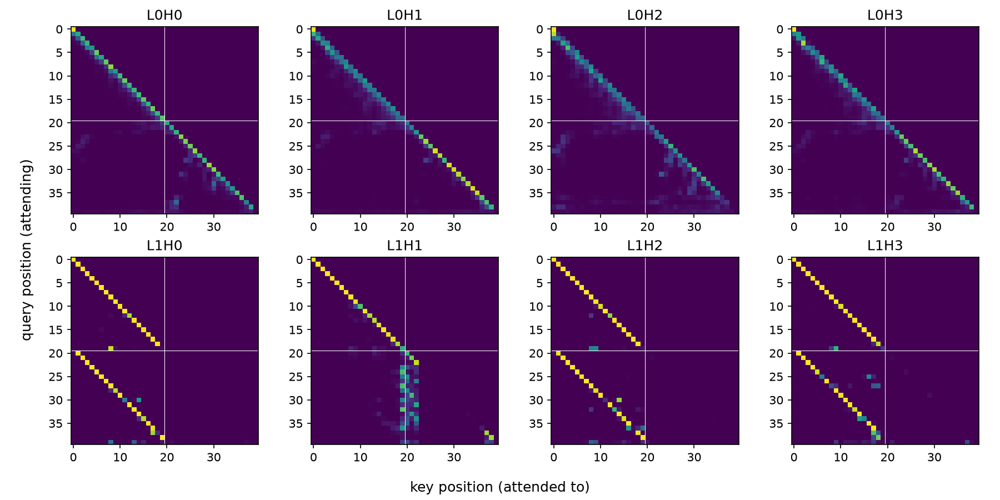
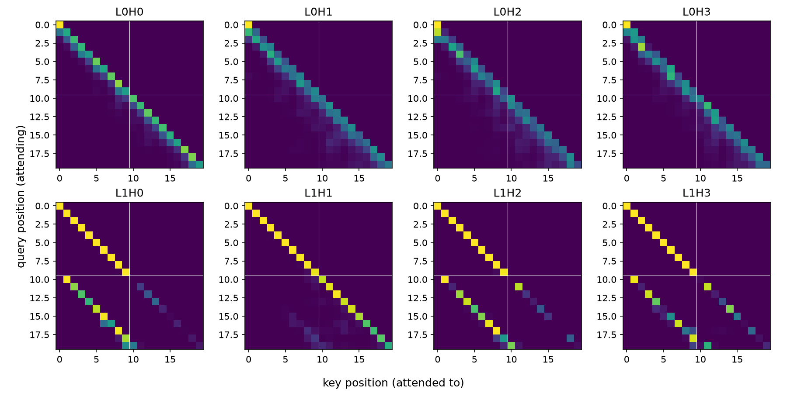
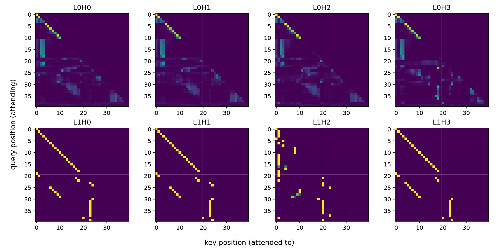
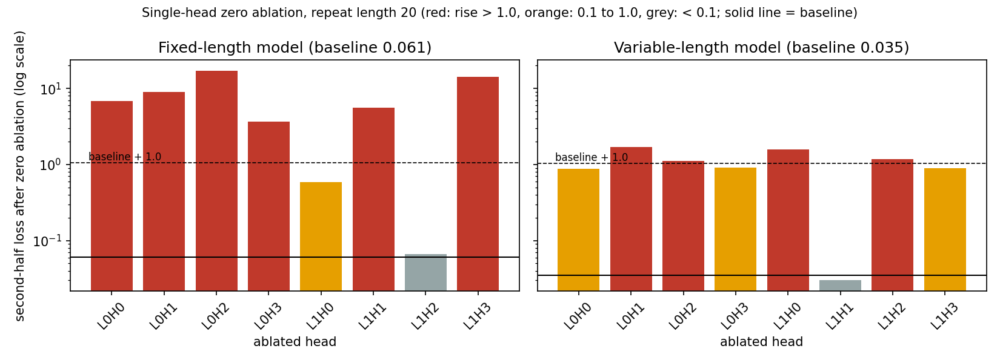

# info.md: theory notes and remarks

Working notes for `mi-toy`, in the order the work happened. Every stage has the
theory behind it, what we did, and what surprised us or had to change. New
stages are appended at the end of Part 1 as we go.

Contents: Part 1 (1.1 task, 1.2 dataset, 1.3 model, 1.4 training and
evaluation, 1.5 hook points, 1.6 reading activations), Part 2, open questions,
glossary.

---

# Part 1: toy model in plain PyTorch

## 1.1 Task and hypothesis

**Theory.** We want a task where we know which mechanism a model needs, so we
can check whether interventions find it. The classic choice is *induction*:

> If the text contains `[A][B] ... [A]`, then after the second `[A]` predict `[B]`.

Each training sequence is a random block of tokens repeated twice, e.g.
`K R P Z K R P Z`. The model is trained only on next-token prediction, at every
position. The tokens are random and meaningless on purpose: language knowledge,
memorization and token statistics cannot help, so the only way to lower the loss
in the repeated part is to look back in the context.

**What we write and what the model learns.** We write the data and the loss. We
do not write any rule such as "check for repeats". Gradient descent keeps
whatever lowers the loss, so some look-back behavior emerges in the weights.
Learning the rule happens across training (weights change). Using the rule
happens inside one forward pass (weights fixed).

**First half vs second half.** This is not a second task or a special input
format. It is only how we group positions when reporting the loss. Training uses
the average over all positions. In the first half the tokens are new random
draws, so even a perfectly trained model is at chance there (about ln(100) =
4.6). The first token of the second half is also unpredictable, because the
model cannot know the repeat is starting. Only the following positions are
predictable.

**Hypothesis.** The model learns the look-back behavior on its own, and
interventions can locate the components responsible. This is a hypothesis to
test, not a guarantee.

**Caveat (planned from the start).** Copying is not necessarily induction. With a
fixed repeat length, a positional shortcut ("predict the token that was
`half_len` positions ago") also scores perfectly. We planned to test on other
repeat lengths and to inspect the attention patterns. This caveat turned out to
matter (see 1.4).

## 1.2 Dataset

**Theory and what we did.** `make_batch(batch_size, half_len, vocab_size)` returns
an integer tensor of shape `(batch_size, 2 * half_len)`: a random half
concatenated with a copy of itself along the sequence dimension. Tokens are
integer ids, because the model never sees letters, only ids. Every training step
draws fresh random sequences, so nothing can be memorized and the training loss
is already a fair measure of generalization.

**Seeding.** `set_seed(seed)` seeds Python's `random`, NumPy and PyTorch. The same
seed gives the same initial weights and the same data stream. The seed is also an
experimental variable: different seeds can end up with different circuits for the
same behavior (the Rashomon question, see Open questions). Seeding gives
repeatability on the same machine and software versions, not bit-exact
determinism on every device.

**Change: sampling without replacement.** The first version drew tokens with
`randint`, and I wrongly claimed duplicates would be rare. It is the birthday
problem: drawing 20 tokens from 50 gives about 4 duplicate pairs per sequence,
and even a vocabulary of 256 leaves roughly a third of sequences with at least
one duplicate. A duplicated token followed by two different tokens makes the
second-half prediction ambiguous for a pure look-back strategy. The fix is to
take the first `half_len` columns of a random permutation of the vocabulary
(`torch.rand(...).argsort(dim=1)[:, :half_len]`), so tokens within a sequence are
distinct. This requires `vocab_size >= half_len`. A side effect: the first-half
loss floor is slightly below ln(vocab), because already-seen tokens are excluded.

## 1.3 Model

**Design choices.** An attention-only transformer, 2 layers, no MLPs, no layer
normalization, no biases. These remove the hardest-to-interpret components and
keep each head to four matrices. Induction needs two layers that compose: a
layer-0 head that moves "what was my previous token" into each position, and a
layer-1 head that uses it to find the position after the earlier occurrence of
the current token and copy from there.

| Config | Value | Meaning |
|---|---|---|
| `vocab_size` | 100 | Distinct tokens |
| `n_ctx` | 40 | Maximum sequence length (2 * 20) |
| `n_layers` | 2 | Attention layers; induction needs two that compose |
| `n_heads` | 4 | Parallel heads per layer; roles are learned |
| `d_head` | 16 | Size of each head's query/key/value/output vector |
| `d_model` | 64 | Residual stream width (4 * 16 by convention, not a constraint) |

**Embeddings.** `W_E` has shape `(vocab_size, d_model)`: a lookup table, one row
per token. The same token gets the same vector everywhere, so we add `W_pos`,
shape `(n_ctx, d_model)`, one learned vector per position (GPT-2 style), because
attention alone has no sense of order. Token vector plus position vector is the
starting value of the **residual stream**. Both tables start as small random
numbers (std 0.02) and are trained.

**Attention.** Each position looks at earlier positions and pulls information
from them. Query: what am I looking for. Key: what do I contain. Value: what do I
hand over if selected. Steps: compare the query with every key (dot product,
divided by sqrt(d_head) so large scores do not saturate the softmax), forbid the
future, softmax into weights that sum to 1, take the weighted sum of the values,
map each head's result back to `d_model` with `W_O` and sum over heads.
Weights are stored per head: `W_Q`, `W_K`, `W_V` have shape
`(n_heads, d_model, d_head)` and `W_O` has shape `(n_heads, d_head, d_model)`, so
heads are separately addressable for interventions. A head splits into a QK
circuit (where it attends) and an OV circuit (what it moves).

**Causal mask.** The model predicts the next token at every position in
parallel. Without the mask, a position could attend to the very token it is
supposed to predict and simply cheat. The mask sets future scores to `-inf`, which
become weight 0 after the softmax, so position `t` only sees `0 ... t`. It does
not fix positions (the positional embedding does that); it prevents looking
ahead.

**Unembedding and assembling.** `W_U`, shape `(d_model, vocab_size)`, turns the
final residual vector into one score (logit) per token. It is a separate learned
matrix, not the transpose of `W_E` (no weight tying), so reading from a token and
writing toward a token can be studied independently. The model is
`embed + pos_embed`, then for each layer `x = x + layer(x)` (the residual
connection), then unembed. The residual connection is what lets layer 1 read
what layer 0 wrote (composition), and makes the final stream a plain sum of named
contributions. Because there is no final normalization, the logits are exactly
linear in that sum, which will make direct logit attribution exact.

**Sanity checks passed.** Output shape `(8, 40, 100)`; 48,128 parameters (6,400
`W_E` + 2,560 `W_pos` + 2 * 16,384 attention + 6,400 `W_U`); untrained loss
about 4.605 = ln(100).

**Design note.** No layer normalization may make training less stable and lets
logits grow unbounded (this showed up later, see 1.4).

## 1.4 Training and evaluation

**Loss.** The model's output at position `i` is its guess for the token at
`i + 1`, so we drop the last logits and the first token and compare the two
(`per_position_loss`). Cross-entropy is `-log(probability given to the correct
token)` after a softmax; it punishes confident wrong answers heavily (0.99 gives
0.01, 0.5 gives 0.69, 1/100 gives 4.6). We keep one loss per prediction, shape
`(batch, 39)`, and average only for training or for reporting.

| Loss entries | What is predicted | Best possible loss |
|---|---|---|
| 0 ... 18 | first-half tokens | about ln(100), slightly lower |
| 19 | first token of the second half | about ln(100) |
| 20 ... 38 | rest of the second half | about 0 if the look-back rule works |

**Training.** AdamW, learning rate 1e-3, weight decay 0.01, batch size 64, fresh
data every step, no dropout. The first and second-half losses are logged every
100 steps. Weights are saved with `state_dict` (checkpoints `*.pt` are ignored by
git) and reloaded into a freshly built `Transformer`.

**Run 1: fixed repeat length 20 (seed 0, 10,000 steps).** Second-half loss fell
from 4.6 to 0.033; first half stayed at chance (about 4.65, even slightly above
ln(100), probably because the confident look-back behavior also fires in the first
half where there is nothing to copy).

**Surprise: a positional shortcut, not induction.** Low second-half loss only
shows that the model copies, not how. We tested on other repeat lengths (10
batches of 256 sequences each):

| Repeat length | First half | Second half |
|---|---|---|
| 5 | 4.660 | 4.697 |
| 10 | 4.671 | 4.641 |
| 15 | 4.668 | 61.162 |
| 20 (trained) | 4.661 | 0.059 |

Criteria fixed before running: second half below about 0.5 means content-based,
above about 3 means positional, in between means mixed. All shifted lengths are
above 3. The model seems to have learned "at position p (19 or later), predict the
token 20 positions back". That explains everything: for lengths 5 and 10 no
position reaches 19, so the rule never fires (chance); for length 15, positions 20
to 28 confidently copy from the wrong distance, and since the logits are
unbounded (no normalization) a confident mistake costs about 61. This is inferred
from losses only. Update (see 1.6): the averaged attention profile of the fixed model is consistent
with an offset-19 rule (all layer-1 heads peak at distance 19) but more diffuse than the variable
model's; the profile at repeat length 15 (peak stays at 19, not 14) then confirmed the positional rule.
Link to the research theme: equal accuracy, different mechanism.

**Fix: variable repeat length.** `train` gained `half_len_range`; one repeat length
is sampled uniformly per step (Python's `random`, so the torch stream is
unchanged and the fixed run stays reproducible with `(20, 20)`). With a changing
distance, a fixed-offset rule cannot fit, so only content-based lookup pays off.

**Run 2: lengths 5 to 20 (seed 0, 15,000 steps).** Same test, same test data for
both models:

| Repeat length | Fixed model, second half | Variable model, second half |
|---|---|---|
| 5 | 4.697 | 0.135 |
| 10 | 4.641 | 0.058 |
| 15 | 61.162 | 0.024 |
| 20 | 0.059 | 0.032 |

**What we can and cannot claim.**
- Supported: the variable model copies by content, not by a fixed distance (one set
  of weights works across lengths, which a fixed-offset rule cannot do).
- Not yet supported: that it implements induction (previous-token head plus
  induction head). All tested lengths were inside the training range, and
  behavior alone cannot rule out other content-based algorithms (for example,
  detect the first token reappearing and then copy at that offset).
- Needed: attention patterns of the layer-0 and layer-1 heads, head ablations, and
  a harder behavioral test (a repeated block that starts mid-sequence, or pairs
  that reappear in shuffled order).

Note: Run 1 used 10,000 steps and Run 2 used 15,000, so the comparison is not
step-matched.

## 1.5 Hook points

**Problem.** Our goal is to read and change what happens inside the model. But the
attention pattern is only a temporary variable inside `Attention.forward`, so
there is no way to get at it from outside. Copying `forward` for each experiment
or adding flags and extra return values would make the code messy and fragile.

**Theory.** PyTorch forward hooks attach small functions to *modules* and run them
whenever the module runs. A hook can read what passed through, or return a new
tensor that replaces it. Since hooks work only at module boundaries, we wrap the
tensors we care about in an identity module (`HookPoint`), like an inspection port
on a pipe: with nothing attached the flow is unchanged.

**What we did.** Added `HookPoint` (returns its input unchanged) and routed two
tensors through it: `hook_pattern` (the attention pattern, `(batch, head,
query_pos, key_pos)`) and `hook_z` (each head's result before `W_O`, `(batch, head,
pos, d_head)`). The pattern is for reading what a head attends to; `z` is for
changing or switching off a head.

**What does not change.** The computation, the 48,128 parameters, and the saved
checkpoints (the hook modules have no weights, so the weight names are the same).
Regression check passed: rerunning `evaluate.py` after the change gave exactly the
same eight result lines as before, as expected since nothing numerical changed.

## 1.6 Reading activations and attention patterns

**Theory.** Reading an activation means attaching a hook that stores a copy of the
tensor passing through. Doing this for all hook points in one forward pass gives a
*cache*: a dictionary from hook name to tensor, e.g. `layers.0.hook_pattern`.
Attention patterns are the first thing we look at: for an induction head we expect
a stripe where, at a second-half position holding token `K`, the weight
concentrates on the position right after the earlier `K`; for a previous-token head
we expect a stripe one position back.

**What we did.** `run_with_cache(model, tokens)` in `part1_toy/hooks.py` attaches a
reading hook to every `hook_pattern` and `hook_z`, runs the model under
`torch.no_grad()`, and always removes the hooks afterwards (`try/finally`), because
leftover hooks would keep overwriting cache entries in later runs. Each hook stores
`output.detach()` (values, no gradient graph) and returns nothing, so the model is
unchanged. Keys are the dotted module names, e.g. `layers.1.hook_pattern`. Check on
the variable-length model with 4 sequences of repeat length 10 (20 tokens): patterns
have shape `(4, 4, 20, 20)` and per-head results `(4, 4, 20, 16)` for both layers, as
expected.

**Reading the plots (planned).** Rows are query positions (the position attending),
columns are key positions (the position attended to). Expected signatures: a
previous-token head shows a stripe one position below the diagonal; an induction head
shows, in the second half, a stripe where the query at position `i + half_len` attends
to key `i + 1`, i.e. the key position is `query - half_len + 1`, so the stripe shifts
with the repeat length. A fixed-offset (positional) head would stay at the same
distance whatever the repeat length.

**Results (one random sequence per plot, so qualitative only).**
- Variable-length model, repeat length 20: layer-1 heads L1H0, L1H2 and L1H3 show, in
  the second half, a sharp stripe from (query 20, key 1) to (query 39, key 19), i.e.
  key = query - 19, the position right after the earlier occurrence of the current
  token. In the first half these heads attend to themselves (main diagonal), where
  there is nothing to look back at.
- Same model, repeat length 10: the same three heads show the stripe at
  key = query - 9. The stripe moved with the repeat length, as an induction head's
  should and a fixed-offset head's cannot.
- L1H1 behaves differently: at length 20 it attends around the boundary (keys 19 to
  22) in the second half, and at length 10 it mostly attends to itself. Not a clean
  induction head; role unknown.
- Layer 0 (all four heads): broad, local, roughly diagonal patterns. By eye we cannot
  tell offset 0 (self) from offset 1 (previous token); this needs numbers.
- Fixed-length model: on this one sequence the layer-1 second-half patterns look fragmented (short stripes, a vertical band, isolated points), not a single clean stripe. This turned out to be misleading, see the offset profile below.

**Figures** (one random sequence each; rows are query positions, columns are key
positions, white lines mark the boundary between the halves).

*Variable-length model, repeat length 20: in layer 1, L1H0, L1H2 and L1H3 show a
stripe in the second half (key = query - 19).*

*Same model, repeat length 10: the stripe moves to key = query - 9.*

*Fixed-length model, repeat length 20: fragmented on a single sequence; the averaged
profile below shows why this is misleading.*

Caveats: one sequence per plot, judged by eye; three of four layer-1 heads look
alike (redundancy?). Next: an offset profile (mean attention per distance, averaged
over many sequences) to get numbers, then ablations to test causal role.

**Offset profile** (`part1_toy/analysis.py`; 256 sequences per run; mean attention
weight at each distance back, over the predictable second-half queries).

Variable-length model:
- L1H0, L1H2, L1H3: weight 0.91, 0.83, 0.80 at offset 19 for repeat length 20, and
  0.85, 0.78, 0.72 at offset 9 for length 10. The peak offset equals `half_len - 1` in
  both cases. This confirms numerically that the stripe moves with the repeat length:
  these three heads attend to the token after the earlier occurrence of the current
  token.
- L1H1: mostly self (0.17 at length 20, 0.83 at length 10), induction weight 0.03 to
  0.05. Not an induction head.
- Layer 0: all four heads attend mostly to themselves (0.37 to 0.76); previous-token
  weight is only 0.10 to 0.15 at length 20 and 0.22 to 0.36 at length 10. They are not
  clean previous-token heads, so how layer 1 gets the previous-token information is not
  explained by the self and previous columns alone (the remaining weight is spread over
  other offsets).

Fixed-length model (length 20 only):
- All four layer-1 heads peak at offset 19, with weights 0.29, 0.32, 0.12, 0.42, much
  more diffuse than the variable model's 0.8 to 0.9. At a single repeat length, offset
  19 cannot be told apart from induction, so this is consistent with the fixed-offset
  rule but does not prove it.
- Layer 0 heads attend far back (peak offset 18 for three heads, 37 for L0H2) with
  small weights, unlike the variable model's local layer 0.
- Correction: my earlier reading of the single-sequence plots ("does not match the
  offset story") was premature; the averaged profile is consistent with it.
- Decisive test (done): the fixed model's profile at repeat length 15. Peak at offset 19
  would mean a fixed offset, peak at 14 would mean induction. Result: all four layer-1
  heads still peak at offset 19, with weights 0.55, 0.60, 0.20 and 0.80 (L1H3 puts 0.80
  on a single wrong distance), and put 0.00 to 0.06 on offset 14. So the fixed model
  attends a fixed distance back, regardless of the repeat length: the positional
  explanation from 1.4 is confirmed from the inside. This also explains the loss of 61
  at length 15 (sharp attention at the wrong place).

**Offset profile, summary tables.**

Variable-length model, mean attention weight at the induction offset
(`half_len - 1`) and the peak offset:

| Head | Repeat length 20 (offset 19) | Repeat length 10 (offset 9) | Reading |
|---|---|---|---|
| L1H0 | 0.91 | 0.85 | induction |
| L1H2 | 0.83 | 0.78 | induction |
| L1H3 | 0.80 | 0.72 | induction |
| L1H1 | 0.03 to 0.05 | 0.03 to 0.05 | not induction (mostly self: 0.17 and 0.83) |
| L0H0 to L0H3 | not at the induction offset | not at the induction offset | mostly self (0.37 to 0.76), previous-token only 0.10 to 0.36 |

Fixed-length model, layer 1 heads, peak offset and its weight at two repeat lengths
(the decisive test: an induction head's peak moves with the repeat length, a
positional head's does not):

| Head | Length 20: peak, weight | Length 15: peak, weight | Weight at offset 14 (induction) |
|---|---|---|---|
| L1H0 | 19, 0.29 | 19, 0.55 | 0.00 to 0.06 |
| L1H1 | 19, 0.32 | 19, 0.60 | 0.00 to 0.06 |
| L1H2 | 19, 0.12 | 19, 0.20 | 0.00 to 0.06 |
| L1H3 | 19, 0.42 | 19, 0.80 | 0.00 to 0.06 |

The peak stays at 19 when the repeat length changes to 15, so the fixed model attends a
fixed distance back, not the token after the earlier occurrence.

## 1.7 Zero ablation of single heads

**Theory.** So far we only *read* the model. Reading shows what a head attends to, not
whether the network depends on it. An *intervention* tests that: change a head's
contribution and see what happens to the loss. If removing a head raises the loss on
the predictable half, the head is *necessary* for that behavior (on this
distribution); if it changes nothing, the head is not needed for the task. Necessity
is not the same as sufficiency, or as "this head implements X". Three caveats matter:
1. *Redundancy*: if two heads do the same job, removing one hides its importance.
2. *Off-distribution damage*: replacing a head's output with zeros gives the next
   layers an input they never saw in training. With no layernorm in our model, logits
   are unbounded, so the damage can be huge and partly an artifact.
3. *Zero is an arbitrary baseline*: mean ablation (replace the output with its average
   over data) removes the input-specific information but keeps activations in a normal
   range, and is the cleaner test (still to do).

**Decision rule, fixed before the run.** Measure the loss on the predictable second
half. A rise above about 1.0 over the baseline is "large"; a rise below about 0.1 is
"negligible"; in between is "moderate".

**What we did.**
- `make_zero_ablation_hook(head)` in `part1_toy/hooks.py`: a hook that returns a
  *copy* of the `hook_z` output with one head's slice set to 0. Returning a tensor from
  a forward hook replaces the module output; the `.clone()` avoids editing the original
  tensor in place.
- `run_with_ablation(model, tokens, heads)`: registers the hooks on
  `layers[layer].hook_z` (the head result before `W_O`, so zeroing it removes exactly
  that head's write to the residual stream), runs the model under `torch.no_grad()`,
  and removes the hooks in `finally`.
- `ablated_loss(...)` in `part1_toy/ablation.py`: averages the per-position loss over
  10 batches of 256 fresh sequences, reporting first half (positions before the
  boundary) and second half separately. `set_seed(0)` is called before every
  measurement so all conditions see the same sequences (fair comparison).
- Sweep: baseline plus each of the 8 heads, repeat length 20, for both models.

**Sanity check.** The no-ablation baselines (fixed 0.061, variable 0.035) match the
earlier evaluation (0.058 and 0.033), so the machinery does not disturb the model.

**Results** (second-half loss; first-half loss in the last column, where chance is
about 4.6):

Variable-length model (baseline: first 4.725, second 0.035)

| Ablated | Second-half loss | Rise | Verdict | First-half loss |
|---|---|---|---|---|
| L0H0 | 0.884 | 0.85 | moderate | 4.974 |
| L0H1 | 1.710 | 1.68 | large | 5.377 |
| L0H2 | 1.115 | 1.08 | large | 5.314 |
| L0H3 | 0.908 | 0.87 | moderate | 5.142 |
| L1H0 | 1.589 | 1.55 | large | 6.796 |
| L1H1 | 0.030 | -0.005 | negligible | 8.006 |
| L1H2 | 1.166 | 1.13 | large | 6.417 |
| L1H3 | 0.887 | 0.85 | moderate | 6.155 |

Fixed-length model (baseline: first 4.664, second 0.061)

| Ablated | Second-half loss | Rise | Verdict | First-half loss |
|---|---|---|---|---|
| L0H0 | 6.827 | 6.77 | large | 9.547 |
| L0H1 | 9.029 | 8.97 | large | 5.945 |
| L0H2 | 17.100 | 17.04 | large | 10.164 |
| L0H3 | 3.633 | 3.57 | large | 7.957 |
| L1H0 | 0.588 | 0.53 | moderate | 9.515 |
| L1H1 | 5.612 | 5.55 | large | 30.349 |
| L1H2 | 0.066 | 0.005 | negligible | 4.662 |
| L1H3 | 14.298 | 14.24 | large | 42.999 |

*Second-half loss after ablating each head (log scale). Solid line: baseline; dashed
line: baseline + 1.0. This figure was drawn from the numbers in the tables above.*

**Reading the results.**
- *Variable-length model.* Every layer-0 head and the three induction heads (L1H0,
  L1H2, L1H3) raise the loss to 0.9 to 1.7, but none breaks the model completely (an
  unrelated token would cost about 4.6): consistent with partial redundancy. L1H1 is
  negligible (0.030 vs 0.035), matching the offset profile, where it shows no induction
  attention: it is not part of the copying. The layer-0 result fits the circuit
  picture (induction needs a previous-token signal), but all four layer-0 heads
  contribute, not one or two clean previous-token heads.
- *Fixed-length model.* Much more fragile: six of eight heads are large, some
  catastrophic. Only L1H2 is negligible and L1H0 moderate, so the positional solution
  is concentrated in few heads.
- *Off-distribution caveat.* First-half losses far above 4.6 (up to 43) cannot be
  "missing information": a model that has lost a feature should be at chance, not far
  worse. They show that zeroing pushes the unnormalized network outside its training
  range. The size of the fixed model's numbers, and the ranking among its large
  effects, should not be over-interpreted.
- *What this does and does not show.* Zero ablation supports "removing this head
  hurts or does not hurt on this task". It does not show that a head implements a
  given function, or that the listed heads form the complete circuit.

**Next.** Group ablation of the three induction heads together (the loss near 4.6 would
mean they are the whole copying mechanism, much lower would mean the circuit is
larger); mean ablation to test the off-distribution artifact; then direct logit
attribution and activation patching.

---

# Part 2: GPT-2 small and IOI

_Not started._

---

# Open questions and candidate research ideas

- **Same behavior, different mechanism.** Part 1 already gave a small instance: a
  fixed-length model and a variable-length model with the same accuracy on the
  trained length but different mechanisms. Is this a general problem for circuit
  claims (Rashomon set of circuits)? How would one measure circuit uniqueness
  across seeds and training distributions?
- **How reliable are behavioral tests for mechanisms?** Our three-row decision
  rule separated the two models, but only because we picked a discriminating test.
  Which tests are sufficient?
- **Faithfulness metrics.** Different metrics and corruption choices can give
  different circuits for the same behavior (to be checked in Part 2).

---

# Glossary

| Term | Short meaning |
|---|---|
| Residual stream | Shared vector per token position that every layer reads from and adds to |
| Attention head | Reads the stream, decides where to attend (QK) and what to move (OV), writes back |
| Attention pattern | The weights a head puts on earlier positions, shape `(query_pos, key_pos)` per head |
| Causal mask | Forbids attending to later positions |
| Logit | Pre-softmax score for a vocabulary token |
| Cross-entropy | `-log` of the probability given to the correct token |
| Induction | After `[A][B] ... [A]`, predict `[B]`; implemented by a previous-token head plus an induction head |
| Positional shortcut | Copying from a fixed distance back instead of looking tokens up by content |
| Hook point | Identity module that lets hooks read or replace an internal activation |
| Cache | Dictionary of saved activations from one forward pass |
| Direct logit attribution (DLA) | Contribution of one component to the final logits through the residual stream |
| Ablation | Remove a component's contribution (zero or mean value) and observe the change |
| Activation patching | Copy an activation from one run into another and observe the change |
| Clean / corrupted prompt | The two inputs used in patching; differ in the minimal detail that matters |
| Faithfulness | The found circuit alone reproduces the model's behavior |
| Superposition | More features than dimensions, stored as almost-orthogonal directions |
| Weight tying | Using the transpose of `W_E` as `W_U` (not done here) |
